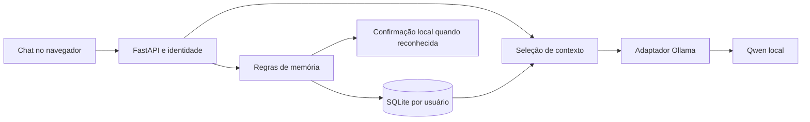

# Cognitive Memory Agents

**Curso:** EAD_PROINT_100.DD-ADS-PI-10-74.2026.74  
**Disciplina:** Projeto Integrador
**Instituição:** Faculdade UniAnchieta

**Integrantes:**
- Ezequiel da Silva Manço — RA: 2410701
- Vinícius Silva Dos Santos — RA: 2412504
- Paloma Quimbely de Lima Silva — RA: 2411659

Este projeto corresponde ao Tema 11 de um conjunto de 16 temas propostos para a disciplina e representa o primeiro trabalho desenvolvido para a construção do portfólio da equipe. Os demais temas serão explorados posteriormente, com foco no aprendizado contínuo, na troca de experiências e na diversificação dos papéis e responsabilidades entre os integrantes.


---

## O que o projeto faz

Chatbot com memória persistente por usuário: salva fatos, recupera informações em novas sessões, substitui fatos atualizados e permite esquecer. A aplicação integra FastAPI, SQLite, regras de memória e o modelo local `qwen2.5-coder:3b` pelo Ollama. Operações inteiramente reconhecidas recebem confirmação local; respostas factuais com suporte e perguntas gerais continuam no modelo.

**Estado:** candidata v3, publicada no [PR #45](https://github.com/codezeck/cognitive-memory-agents/pull/45), aguardando revisão humana e integração. A tag final `v1.0`, o vídeo e o envio acadêmico ainda não estão concluídos. Consulte [pendências por responsável](docs/pendencias-equipe.md).

## Baixar e executar

Pré-requisito: Docker Desktop iniciado, usando contêineres Linux e Docker Compose. Git é necessário somente para clonar; também é possível baixar o ZIP da branch no botão **Code** do GitHub. A primeira execução precisa de internet, espaço para imagens/pesos e tempo para o download. Não exige Python, Ollama no host ou chave de API paga.

Enquanto o PR estiver aberto, baixe a branch da candidata:

```powershell
git clone --branch fix/confiabilidade-contexto-memoria https://github.com/codezeck/cognitive-memory-agents.git
cd cognitive-memory-agents
docker compose --env-file .env.example up --build
```

Abra **http://127.0.0.1:8001/** após o preparo terminar. O chat usa os perfis sintéticos A/B com acesso local automático; não copie tokens. Alternativa no Windows: execute **`.\Iniciar.ps1`** na raiz para preparar e abrir o navegador automaticamente.

O [manual do professor](docs/manual-professor.md) apresenta o percurso completo, requisitos observados, resultados esperados, reinício e solução de problemas. Depois de publicar `v1.0`, o roteiro final deve apontar para essa tag, garantindo que vídeo, testes e pesquisa correspondam ao código entregue.

## Como o professor pode conferir

| Conferência | Onde encontrar |
|---|---|
| Instalar, conversar, salvar, atualizar, reiniciar e esquecer | [Manual com exemplos e capturas](docs/manual-professor.md) |
| Inspecionar endpoints e erros | [Referência da API](docs/api.md); OpenAPI em `http://127.0.0.1:8001/docs` |
| Reproduzir o comparativo e as 20 sessões | [Avaliação v3 com Docker](docs/reproduzir-avaliacao-v3.md) |
| Executar testes e entender os ignorados | [Testes e integração contínua](docs/testes-e-ci.md) |
| Conferir pesquisa, métricas e arquivos originais | [Pesquisa PDF](docs/pesquisa-abnt.pdf), [relatório v3](docs/acertos-tokens-contexto-v3.md), [índice de evidências](evidencias/entrega-v3-20261118/README.md) |
| Consultar o estado da publicação | [PR #45](https://github.com/codezeck/cognitive-memory-agents/pull/45), [GitHub Actions](https://github.com/codezeck/cognitive-memory-agents/actions/workflows/tests.yml), [checklist](docs/checklist-entrega.md) |

## Resultados medidos e limites

| Experimento | Memória automática | Comparação de tokens completos |
|---|---|---|
| P6: 20 sessões por cenário | 21/21 respostas aprovadas pelo julgador P4 | 3.593 contra 22.228; redução de 83,84% em 20/20 pares |
| Validação sintética: 16 casos × 3 repetições | 48/48 aprovações P4 | 6.025 contra 39.844; redução de 84,88% em 47/48 pares |

Na P6, o baseline teve oito aprovações, uma reprovação verificada e doze respostas não verificadas: isso não equivale a doze erros semânticos. Na validação houve um timeout do baseline, cujo custo é desconhecido. O cálculo de tokens usa somente pares medidos. As regras e o julgador têm gramática limitada; os dados são sintéticos e conhecidos pela equipe. Não se demonstrou equivalência estatística nem generalização irrestrita. Resultados negativos anteriores permanecem no [histórico experimental](docs/resultados-avaliacoes-agente.md).

## Arquitetura e documentação



Pesos, banco e credenciais usam volumes distintos. A API recupera por chave em consultas reconhecidas e usa hashing lexical no fallback; o benchmark semântico é uma avaliação separada. [Cinco decisões de arquitetura](docs/decisoes-arquitetura.md) registram contexto, decisão, alternativas e consequências. O [índice da documentação técnica](docs/README.md) reúne os nove itens do enunciado.

## Configuração e segurança

O Compose usa `.env.example`, prepara Ollama/modelo e gera credenciais aleatórias em volume privado. As variáveis efetivas são descritas na [referência da API](docs/api.md). `OPENAI_API_KEY` permanece vazia na entrega. O adaptador OpenAI é opcional e teve testes simulados; não foi feita avaliação real desse serviço. Claude e Gemini como provedores do produto são possibilidades futuras.

Use apenas dados sintéticos nos perfis de demonstração. O acesso é local em loopback e os perfis são compartilhados; não publique essa configuração na internet. O histórico fica em RAM por processo e o banco em SQLite. A exclusão total remove linhas ativas/inativas do usuário e limpa seu histórico; excluir um ID tem escopo diferente. Observação literal de RAM/SQLite não certifica conformidade jurídica ou eliminação de todas as cópias externas.

Para parar preservando os volumes:

```powershell
docker compose --env-file .env.example down
```

## Contribuições e uso de IA

| Integrante | Frentes registradas no projeto |
|---|---|
| Ezequiel da Silva Manço — [codezeck](https://github.com/codezeck) | Agente, contexto, provedores, avaliação e consolidação documental |
| Vinícius Silva Dos Santos — [Vinicius000011](https://github.com/Vinicius000011) | Regras, memória, conflitos, recuperação e dados sintéticos |
| Paloma Quimbely de Lima Silva — [Palomalimaa](https://github.com/Palomalimaa) | API, armazenamento, Docker e integração |

Essas frentes não substituem o histórico dos commits ou a revisão cruzada. O [registro de IA](PROMPTS.md) conserva interações com Claude e ChatGPT e a assistência de Codex/ChatGPT nesta etapa. Decisões aceitas, correções e descartes permanecem identificados. [Contexto disponível desta conversa e modelo para os colegas](docs/registro-ia/README.md); os históricos de Paloma e Vinícius ainda precisam ser reunidos por eles.

## Licenças

Código e documentação próprios sob [MIT](LICENSE), com autorização do grupo. Dependências e modelo conservam suas licenças: [NOTICE](NOTICE), [ficha de dados/modelo](docs/dados-modelos.md) e [inventário de terceiros](docs/licencas.md). Os pesos não são publicados no Git. A licença Qwen Research do modelo 3B é distinta da MIT do projeto.
