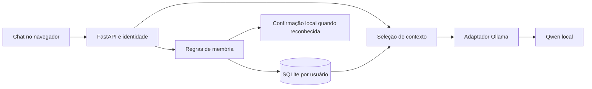

# Cognitive Memory Agents

**Curso:** EAD_PROINT_100.DD-ADS-PI-10-74.2026.74  
**Disciplina:** Projeto Integrador
**Instituição:** Faculdade UniAnchieta

**Integrantes:**
- Ezequiel da Silva Manço — RA: 2410701
- Vinícius Silva Dos Santos — RA: 2412504
- Paloma Quimbely de Lima Silva — RA: 2411659

Este projeto corresponde ao Tema 11 de um conjunto de 16 temas propostos para a disciplina e representa o primeiro trabalho desenvolvido para a construção do portfólio da equipe. Os demais temas serão explorados posteriormente, com foco no aprendizado contínuo, na troca de experiências e na diversificação dos papéis e responsabilidades entre os integrantes.


---

## O que o projeto faz

Chatbot com memória persistente por usuário: salva fatos, recupera informações em novas sessões, substitui fatos atualizados e permite esquecer. A aplicação integra FastAPI, SQLite, regras de memória e o modelo local `qwen2.5-coder:3b` pelo Ollama. Operações inteiramente reconhecidas recebem confirmação local; respostas factuais com suporte e perguntas gerais continuam no modelo.

**Estado:** candidata v3, publicada no [PR #45](https://github.com/codezeck/cognitive-memory-agents/pull/45), aguardando revisão humana e integração. A tag final `v1.0`, o vídeo e o envio acadêmico ainda não estão concluídos. Consulte [pendências por responsável](docs/pendencias-equipe.md).

## Baixar e executar

Pré-requisito: Docker Desktop iniciado, usando contêineres Linux e Docker Compose. Git é necessário somente para clonar; também é possível baixar o ZIP da branch no botão **Code** do GitHub. A primeira execução precisa de internet, espaço para imagens/pesos e tempo para o download. Não exige Python, Ollama no host ou chave de API paga.

Enquanto o PR estiver aberto, baixe a branch da candidata:

```powershell
git clone --branch fix/confiabilidade-contexto-memoria https://github.com/codezeck/cognitive-memory-agents.git
cd cognitive-memory-agents
docker compose --env-file .env.example -p cma-demonstracao up --build
```

Abra **http://127.0.0.1:8001/** após o preparo terminar. O chat usa os perfis sintéticos A/B com acesso local automático; não copie tokens. Alternativa no Windows: execute **`.\Iniciar.ps1`** na raiz para preparar e abrir o navegador automaticamente.

O [manual do professor](docs/manual-professor.md) apresenta o percurso completo, requisitos observados, resultados esperados, reinício e solução de problemas. Depois de publicar `v1.0`, o roteiro final deve apontar para essa tag, garantindo que vídeo, testes e pesquisa correspondam ao código entregue.

## Executar avaliações pela interface

Depois de iniciar a aplicação, abra **Comparativo de tokens**. Não é preciso usar PowerShell para avaliar nem importar um relatório: escolha o protocolo, confira seus objetivos/perguntas e clique em **Executar avaliação**. O Ollama e o modelo local precisam estar disponíveis; a tela explica qualquer bloqueio e oferece **Atualizar disponibilidade**.

- **Comparativo sintético v3:** os mesmos 16 casos em quatro cenários. Uma repetição faz 64 tentativas; três fazem 192. Conferência inicial e avaliação repetida não são dois datasets distintos.
- **P6:** roteiro integral de quatro usuários e cinco sessões em dois cenários, com **20 sessões por cenário, 40 no total e 42 respostas**. Inclui checkpoints de reinício e exclusão da API temporária; não existe P6 abreviada nesta tela.
- **Conjunto próprio:** use **Baixar modelo de teste JSON** e crie de **1 a 20 casos diferentes por arquivo**, até 128 KB, com dados fictícios. Ao pedir ajuda a uma IA, forneça também as [limitações e atributos aceitos](docs/manual-professor.md#limites-para-gerar-um-conjunto-com-ajuda-de-ia). Casos em que o esperado é reconhecer ausência/esquecimento devem usar `tipo_resposta: "abstencao"`; não conte DESCONHECIDO como fato recuperado. Depois escolha **Comparativo sintético v3 → Meu conjunto de casos** e importe. O formato não é P6 personalizada.

Acompanhe progresso e, ao terminar, veja gráficos de tokens/qualidade, objetivos demonstrados, falhos ou inconclusivos e perguntas/respostas/julgamentos. Relatórios novos ficam separados dos históricos; baixar/importar JSON é opcional. Uma bateria por vez, até quatro horas; ela compartilha o modelo e pode tornar o chat mais lento. Dados, credenciais e banco da conversa não são usados nos testes. Consulte o [manual](docs/manual-professor.md#avaliar-pela-interface-sem-terminal) para formatos, limites e interpretação.

## Como o professor pode conferir

| Conferência | Onde encontrar |
|---|---|
| Instalar, conversar, salvar, atualizar, reiniciar e esquecer | [Manual com exemplos e capturas](docs/manual-professor.md) |
| Inspecionar endpoints e erros | [Referência da API](docs/api.md); OpenAPI em `http://127.0.0.1:8001/docs` |
| Reproduzir o comparativo e as 20 sessões | [Avaliação v3 com Docker](docs/reproduzir-avaliacao-v3.md) |
| Executar testes e entender os ignorados | [Testes e integração contínua](docs/testes-e-ci.md) |
| Conferir pesquisa, métricas e arquivos originais | [Pesquisa PDF](docs/pesquisa-abnt.pdf), [relatório v3](docs/acertos-tokens-contexto-v3.md), [índice de evidências](evidencias/entrega-v3-20261118/README.md) |
| Consultar o estado da publicação | [PR #45](https://github.com/codezeck/cognitive-memory-agents/pull/45), [GitHub Actions](https://github.com/codezeck/cognitive-memory-agents/actions/workflows/tests.yml), [checklist](docs/checklist-entrega.md) |

## Resultados medidos e limites

| Experimento / escopo | Qualidade e cobertura | Redução automática × histórico |
|---|---|---:|
| Oficial: histórico de 9 rodadas completas em diferentes versões | 400 tentativas por cenário; descritivo de desenvolvimento | 84,80% consolidada |
| Oficial: versão atual, 16 casos × 3 repetições | 48/48 pares medidos; 33/33 fatos aprovados na automática | 84,91% |
| Personalizado: versão atual, duas rodadas dos mesmos 20 casos | 80/80 pares medidos; na última: automática 42/45 fatos, histórico 44/45 | 74,13% consolidada |
| P6 de 18/11: 20 sessões por cenário | 21/21 respostas P4 na automática; baseline com 12 não verificados | 83,84% em 20/20 pares |

As médias, os quatro cenários e os resultados negativos estão na [consolidação de 20/11](docs/consolidacao-testes-20261120.md), com [JSON/CSV e recálculo](evidencias/consolidacao-interface-20261120/README.md). Não juntar roteiros ou versões diferentes numa economia universal. A P6 posterior completa deste histórico teve 83,64%, em tabela própria. A rodada incompleta permanece identificada com custo desconhecido; não vira zero nem é ocultada.

O conjunto personalizado foi gerado com auxílio de IA e selecionado para compatibilidade; não é teste cego independente. Acertos factuais, abstenções, formato e inconclusivos são critérios separados. A pré-carregada não mede aquisição. Novas rodadas sem memória consultam Ollama diretamente; antigas podem usar política local. Repetições não são usuários independentes, e não se demonstrou equivalência estatística ou generalização irrestrita. Os [resultados históricos](docs/acertos-tokens-contexto-v3.md) e as falhas anteriores permanecem preservados.

## Arquitetura e documentação



Pesos, banco e credenciais usam volumes distintos. A API recupera por chave em consultas reconhecidas e usa hashing lexical no fallback; o benchmark semântico é uma avaliação separada. [Cinco decisões de arquitetura](docs/decisoes-arquitetura.md) registram contexto, decisão, alternativas e consequências. O [índice da documentação técnica](docs/README.md) reúne os nove itens do enunciado.

## Configuração e segurança

O Compose usa `.env.example`, prepara Ollama/modelo e gera credenciais aleatórias em volume privado. As variáveis efetivas são descritas na [referência da API](docs/api.md). `OPENAI_API_KEY` permanece vazia na entrega. O adaptador OpenAI é opcional e teve testes simulados; não foi feita avaliação real desse serviço. Claude e Gemini como provedores do produto são possibilidades futuras.

Use apenas dados sintéticos nos perfis de demonstração. O acesso é local em loopback e os perfis são compartilhados; não publique essa configuração na internet. O histórico fica em RAM por processo e o banco em SQLite. A exclusão total remove linhas ativas/inativas do usuário e limpa seu histórico; excluir um ID tem escopo diferente. Observação literal de RAM/SQLite não certifica conformidade jurídica ou eliminação de todas as cópias externas.

Para parar preservando os volumes:

```powershell
docker compose --env-file .env.example -p cma-demonstracao down
```

## Contribuições e uso de IA

| Integrante | Frentes registradas no projeto |
|---|---|
| Ezequiel da Silva Manço — [codezeck](https://github.com/codezeck) | Agente, contexto, provedores, avaliação e consolidação documental |
| Vinícius Silva Dos Santos — [Vinicius000011](https://github.com/Vinicius000011) | Regras, memória, conflitos, recuperação e dados sintéticos |
| Paloma Quimbely de Lima Silva — [Palomalimaa](https://github.com/Palomalimaa) | API, armazenamento, Docker e integração |

Essas frentes não substituem o histórico dos commits ou a revisão cruzada. O [registro de IA](PROMPTS.md) conserva interações com Claude e ChatGPT e a assistência de Codex/ChatGPT nesta etapa. Decisões aceitas, correções e descartes permanecem identificados. [Contexto disponível desta conversa e modelo para os colegas](docs/registro-ia/README.md); os históricos de Paloma e Vinícius ainda precisam ser reunidos por eles.

## Licenças

Código e documentação próprios sob [MIT](LICENSE), com autorização do grupo. Dependências e modelo conservam suas licenças: [NOTICE](NOTICE), [ficha de dados/modelo](docs/dados-modelos.md) e [inventário de terceiros](docs/licencas.md). Os pesos não são publicados no Git. A licença Qwen Research do modelo 3B é distinta da MIT do projeto.

Na leitura dos resultados, **Fatos corretos** e **Abstenções corretas** têm contagens separadas; “não sei” não é recuperação de um fato disponível. **Conteúdo + formato** exige aprovação integral sem pendência. A seção **Ocorrências que precisam de atenção** lista caso, repetição, esperado, resposta e motivo, com filtros de conteúdo, formato, pendência e erro técnico. Veja os detalhes no [Manual do Professor](docs/manual-professor.md#interpretar-qualidade-e-localizar-falhas-no-relatório). A visualização preserva os julgamentos e arquivos originais.

A interface oferece **Caderno claro/escuro**, alternado pelo botão de lua, e **Histórico de avaliações** por perfil. Os resultados aparecem no início da tela em **quatro faixas no comparativo sintético e duas na P6**, com círculos de fatos/abstenções, legenda, tokens de entrada/saída, chamadas, barras na mesma escala e **Mostrar respostas** dentro de cada cenário. A confirmação de uma nova avaliação usa uma janela do próprio painel. Leituras e downloads do histórico não executam modelos. O mesmo gabarito da tarefa é usado na leitura adicional sem substituir os julgamentos originais. Novas rodadas do comparativo consultam Ollama diretamente no controle sem memória; relatórios antigos podem conter a política local. Consulte o [manual](docs/manual-professor.md#aparência-resultados-e-histórico-de-avaliações).


### Controle sem memória nas novas avaliações da interface

A interface usa o método `comparativo-v3-ollama-direto-v1`. Em cada tentativa
de **Sem memória**, envia somente a pergunta final ao Ollama (`/api/chat`),
sem histórico, memórias, agente ou regra local de abstenção, em um POST sem
repetição automática. O modelo e a pergunta são os mesmos do conjunto; os
parâmetros de geração usam os padrões do modelo no Ollama. O gabarito original
P4 avalia a resposta: qualquer cenário pode acertar. “Não sei”/“DESCONHECIDO”
não fornece um fato solicitado, mas continua correto quando o caso exige
abstenção. Isso não demonstra a recuperação interna da memória do modelo.

Os acertos dos quatro cenários aparecem primeiro; depois vêm os tokens de
geração por sessão, chamadas ao modelo e cobertura da medição. Cobertura de
tokens não é acerto de resposta. Contagens ausentes, inválidas ou não
devolvidas em falha permanecem desconhecidas; não são estimadas nem viram
zero. O controle direto registra uma chamada confirmada quando recebe uma
resposta válida do Ollama, mesmo se for “DESCONHECIDO”. A ingestão desse
controle não realiza chamadas. A preparação do modelo fica fora dos tokens
dos casos e não se afirma medir o custo total do sistema.

Relatórios antigos são preservados e identificados como controle via API,
que podia responder por política local sem chamar o modelo. Eles não são
transformados em resultados de Ollama direto. Histórico completo, memória
automática, pré-carregada e o roteiro P6 mantêm seus executores. A memória
pré-carregada continua sendo um controle com estado-ouro, cuja aquisição
não está incluída na medição. Não compare métodos diferentes como se fossem
repetições da mesma configuração.

Para reprodução por CLI, `src.interface.comparativo` preserva o padrão legado
`--controle-sem-memoria api_local`; acrescente
`--controle-sem-memoria modelo_direto` para reproduzir o novo controle Ollama.
Esse modo não está disponível para OpenAI. O JSON novo registra
`controle_sem_memoria`, `versao_metodo_comparativo`, a via `ollama_direto`
e a latência HTTP direta, separada da latência da API do agente.


Se aparecer **Medição incompleta**, a própria faixa identifica o teste,
repetição e motivo. Um timeout não significa que o cenário inteiro gastou
zero tokens: o total permanece desconhecido e as parcelas recebidas são
exibidas como subtotal. Novas rodadas do comparativo pela interface usam
até 180 segundos por chamada de modelo nos quatro cenários, sem repetir
automaticamente uma pergunta. O limite é exclusivo da avaliação; o chat e
a P6 conservam seus limites. Veja os [limites e medições parciais](docs/manual-professor.md#medição-incompleta-e-tempo-limite).

## Informação antiga e provedor da entrega

A [métrica separada](docs/informacao-antiga-respostas.md) mostra, por cenário, valores antigos devolvidos indevidamente, cobertura e inconclusivos, preservando os julgamentos originais. Ela não confunde menção temporal, esquecimento ou isolamento com esse erro. A leitura dos [relatórios já salvos](evidencias/informacao-antiga-20261121/README.md) não repete modelos.

A entrega usa **Ollama local**, sem depender de créditos de API externa. ChatGPT Plus não é requisito nem inclui o uso da API OpenAI; o faturamento é separado. O adaptador OpenAI permanece opcional, com testes simulados e sem execução real nesta entrega. [Decisão e fonte oficial](docs/openai-opcional.md#escolha-de-provedor-para-a-entrega).


### Análise atualizada da P6 e conferência das entradas

A [análise de conteúdo versionada da P6](docs/julgamento-p6.md) aplica regras iguais aos dois cenários usando as anotações incorporadas no relatório. Os tokens aparecem ao lado dos círculos em cada faixa. Conteúdo, formato e informação proibida continuam separados; as notas P4 originais permanecem nos detalhes e no JSON baixado. Esta atualização não muda o comparativo sintético nem os testes com arquivo próprio. A [conferência de segurança das entradas](docs/seguranca-entradas.md) usa banco temporário e navegador simulado.

Antes de remover uma cópia local, conclua a rodada em andamento, confira a publicação dos arquivos e preserve os resultados necessários. O [percurso de revalidação em cópia nova](docs/revalidacao-clone.md) diferencia clone limpo de volumes Docker vazios.


### Validação funcional concluída pelo usuário — 21/11

Ezequiel concluiu a validação no escopo ensaiado e autorizou publicar as atualizações. O [relatório das cinco P6 de hoje](docs/fechamento-avaliacao-20261121.md) registra **85,62% de redução consolidada**, com cem pares medidos: média de 24.868,8 tokens por rodada no histórico e 3.576,6 na automática. É um consolidado P6 separado dos casos sintéticos e personalizados, com mesmas fontes de geração e anotações identificadas por hashes. Na última P6: 16/17 fatos aprovados e um inconclusivo na automática; histórico com 9/17 aprovados, quatro reprovados e quatro inconclusivos na análise v2. Os limites do julgador e as notas originais permanecem visíveis. Esse aceite não substitui revisão humana de PR, CI da versão publicada, vídeo, validação do clone novo ou envio.
