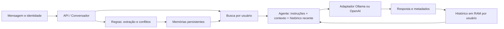

# Contribuição de Zeck para a pesquisa acadêmica

Preparação em 12/11/2026. Responsabilidade: agente, provedores, contexto, julgador e avaliação. Este é um texto para integração ao trabalho coletivo, não o PDF ABNT final nem uma nova execução experimental.

Base desta documentação: `master` em `fc759f31f47ca4fb8dc6b28e5b4f5491cddda986`. A [PR #41](https://github.com/codezeck/cognitive-memory-agents/pull/41), commit `29d1255`, continua aberta: `p4-v3`, 21/21 anotações compatíveis e tratamento público de resposta vazia são entregas em revisão, não funcionalidades já integradas nesta base. A PR documenta 826 testes aprovados; não os reexecutei nem os atribuí à master nesta preparação documental.

Documentos complementares: [resultados e figuras](resultados-avaliacoes-agente.md), [roteiro do vídeo](roteiro-demonstracao.md), [plano P6](plano-execucao-p6.md). Comandos e contratos detalhados continuam no [guia de avaliação](guia-avaliacao.md); limitações concretas já descritas em [casos de falha](casos-de-falha.md) devem ser referenciadas, não reescritas.

## 1. Requisitos acadêmicos e encaixe da contribuição

Fonte: `reference/Projetos-IA-Programacao-Enunciados.md`, versão de 09/10/2026, seções Calendário, Repositório e itens de envio, Evidências de funcionamento, Documentação a entregar e Tema 11. A pasta `reference/` é local e ignorada pelo Git; o grupo deve conferir eventuais orientações posteriores do professor.

| Requisito encontrado | Preparação de Zeck | Dependência para concluir a entrega coletiva |
|---|---|---|
| Marco 3, 14/11: MVP, protocolo, dados separados, baseline; introdução, referencial e metodologia | Texto nas seções 2–5 e protocolos existentes | Validar o MVP em 20 sessões; integrar as partes dos colegas |
| Marco 4, 21/11: experimentos concluídos, congelamento, documentação e rascunho completo | Inventário de resultados e plano de execução | Rodadas reais, versão congelada e revisão coletiva |
| Pesquisa em `docs/pesquisa-abnt.pdf`, 12–20 páginas textuais | Conteúdo de agente, arquitetura, metodologia, resultados e limitações | Montagem/formatação coletiva; este Markdown não substitui o PDF |
| Introdução, referencial, metodologia, resultados/discussão e considerações finais; pré/pós-textuais | Texto aproveitável nas seções abaixo | Capa, resumo/abstract, sumário, referências e integração das demais contribuições |
| Pelo menos 8 referências, ao menos 4 científicas/oficiais/normativas | Oito fontes primárias verificadas na seção 8, seis delas artigos/preprints | Conferência final das citações no texto coletivo e formato institucional |
| Técnica: arquitetura e fluxo, instalação, 3–5 decisões, API/interface, dados/modelos, avaliação, testes/CI, limitações e manual com capturas | Referências existentes, plano e roteiro; descrição acadêmica da arquitetura | Equipe completa decisões, licenças, fichas e manual; Paloma mantém infraestrutura/API, Vinicius dados/memória |
| Vídeo de 3–5 minutos, tela inteira, `docker compose up` e fluxo principal | Roteiro de 4min30s com critérios observáveis | Ensaio/gravação real no ambiente da versão final |
| Evidências: CI verde na tag `v1.0` com captura/link; resultados brutos, tabelas/gráficos, logs datados, três falhas, histórico/revisão e índice | Mapa de afirmações/evidências e figuras propostas | Tag e artefatos finais; não substituir CI da tag por CI da PR |
| Cinco capturas de situações são opcionais na tabela de evidências | Roteiro sugere capturas úteis | O manual técnico exige capturas; não confundir essa exigência com a quantidade opcional de cinco |
| Tema 11: continuidade em 20 sessões, lembranças corretas, desatualizações, tokens/sessão versus histórico e exclusão automatizada | Metodologia e plano P6; testes existentes como evidência de engenharia | Aprovação dos contratos e medição real ponta a ponta |
| Custo zero, dados sintéticos, segredos fora de artefatos, registro de IA e revisão humana | Usar Ollama como caminho principal; manter limites explícitos | Conferir `PROMPTS.md`, licenças, vídeo e defesa individual de todos |
| Entrega entre 30/11 e 02/12; tag `v1.0` até 02/12 | Material pronto para integrar | Equipe confirma canal de envio e cria a versão final |

O enunciado pede normas ABNT para apresentação, citações, referências, resumo, sumário e seções; especifica A4, fonte 12, espaçamento 1,5 e margens de 3 cm superior/esquerda e 2 cm inferior/direita. Aplicar esses requisitos no editor do trabalho coletivo e conferir a orientação institucional vigente. Não há requisito identificado de pagar por OpenAI, migrar obrigatoriamente para PostgreSQL ou obter 100% de acerto.

## 2. Texto proposto — introdução e problema de pesquisa

Assistentes de linguagem precisam selecionar quais informações de uma interação anterior devem permanecer disponíveis em uma nova sessão. Reenviar o histórico integral aumenta o volume de contexto, enquanto descartar conversas anteriores prejudica a continuidade. Além disso, fatos mudam: uma informação anteriormente válida pode precisar ser substituída ou removida. O problema investigado neste projeto é como integrar uma memória externa ao contexto de um assistente, preservando a separação entre usuários e tornando observáveis atualização, recuperação e esquecimento.

O objetivo é desenvolver e avaliar um chatbot com memória persistente, usando um modelo local como caminho de execução a custo zero. A pergunta de pesquisa proposta é: **como a seleção de memórias altera a qualidade das respostas e o consumo de tokens em comparação ao envio do histórico completo, incluindo situações de atualização e exclusão?** A hipótese de redução de contexto deve ser testada junto com qualidade, cobertura e custos de aquisição; ela não é uma conclusão antecipada de economia total ou de manutenção do acerto.

A contribuição de Zeck consiste em organizar o contexto do agente, desacoplar a geração por adaptadores, definir o comparativo experimental e implementar julgamentos e métricas auditáveis. A lógica de fatos e conflitos pertence a Vinicius; API, armazenamento e infraestrutura pertencem a Paloma. A avaliação ponta a ponta depende da integração dessas três frentes.

## 3. Texto proposto — fundamentação e trabalhos relacionados

Vaswani et al. (2017) apresentam a arquitetura Transformer baseada em atenção, uma referência para a discussão de modelos de linguagem. Isso contextualiza o componente gerador do projeto; o grupo não treinou um Transformer nem avaliou sua arquitetura interna. [Fonte primária](https://arxiv.org/abs/1706.03762).

A extensão de uma janela de entrada não garante uso uniforme de todas as informações. Liu et al. (2024) observam variação de desempenho conforme a posição da informação em contextos longos. O resultado motiva comparar histórico integral e contexto selecionado, mas não demonstra que a mesma magnitude de efeito ocorre no modelo local usado aqui. [Fonte primária](https://aclanthology.org/2024.tacl-1.9/).

Lewis et al. (2020) combinam memória paramétrica e recuperação em uma arquitetura RAG. A relação com este projeto é conceitual: recuperar informação externa para condicionar a geração. Nossa implementação não reproduz o treinamento, o índice de Wikipedia ou o recuperador neural daquele artigo; utiliza fatos sintéticos associados ao usuário e regras próprias de atualização. [Fonte primária](https://arxiv.org/abs/2005.11401).

Packer et al. (2023) propõem gerenciamento de diferentes níveis de memória para ampliar o contexto utilizável em interações e documentos. Sumers et al. (2023) organizam agentes por componentes de memória, ações e decisão no framework CoALA. Esses trabalhos ajudam a distinguir histórico transitório, memória persistente e controle de execução. O nome do projeto não significa implementação de MemGPT ou de todo o framework CoALA. [MemGPT](https://arxiv.org/abs/2310.08560), [CoALA](https://arxiv.org/abs/2309.02427).

Reimers e Gurevych (2019) descrevem embeddings de sentenças adequados a comparações de similaridade. O conceito fundamenta a distinção entre semelhança lexical e semântica. O projeto possui um benchmark com embedder semântico e um hash lexical determinístico; o resultado de um não pode ser atribuído ao outro, nem à geração do chatbot. [Fonte primária](https://aclanthology.org/D19-1410/).

As bibliotecas Python oficiais de Ollama e OpenAI são referências de integração com provedores. No trabalho, elas sustentam a origem dos clientes utilizados, não uma comparação experimental entre os serviços nem a validação de versões futuras dos SDKs. Os contratos efetivamente usados estão no código e nas dependências do repositório. [Ollama](https://github.com/ollama/ollama-python), [OpenAI](https://github.com/openai/openai-python).

## 4. Texto proposto — arquitetura do agente e memória contextual

O agente recebe a mensagem atual, a identidade do usuário, memórias externas e um adaptador opcional de geração. `src/agent.py:responder` combina o prompt de sistema, o contexto recuperado e o histórico recente. O prompt orienta respostas em português, fidelidade aos fatos registrados, distinção entre evidência e inferência e abstenção quando faltar informação. Essas instruções são mecanismos de controle de comportamento; não constituem garantia de factualidade ou de ausência de vazamento.

O histórico em RAM é separado por usuário. A chamada inclui até nove interações anteriores e a pergunta atual; após sucesso, o agente conserva até dez pares de mensagens. O limite é de interações, sem orçamento por tokens. Uma falha não acrescenta o turno incompleto. A memória recuperada é contexto da chamada, mas uma resposta pode reproduzir o fato e conservá-lo no histórico. Por isso, exclusão persistente e invalidação contextual precisam ser verificadas separadamente.

`ModeloLLM` define o contrato textual `gerar`; a capacidade opcional `gerar_com_detalhes` fornece resposta e metadados de tokens. `AgenteLocal` seleciona o adaptador por provedor/modelo. Ollama permite execução local; OpenAI é uma integração opcional com credencial em variável de ambiente. A existência dos dois adaptadores não demonstra equivalência de custo, qualidade, tokenização ou janela de contexto. A evidência experimental principal disponível usa o modelo local identificado pela documentação como `qwen2.5-coder:3b`; não há estudo comparativo Ollama versus OpenAI versionado.

Na aplicação integrada, `Conversador` aplica decisões do gerenciador, recupera memórias e passa os textos ao agente. A persistência desta base é SQLite; a recuperação padrão usa `EmbedderHash`, não pgvector nem o embedder semântico do benchmark. A CLI de `src.agent` é uma demonstração com usuário fixo e não conecta esse fluxo persistente. A propriedade de continuidade deve ser demonstrada pela API entre sessões, e não apenas por uma conversa mantida no mesmo processo.

O desenho descreve o fluxo implementado, não o cronograma da P6. Os detalhes técnicos de memória e infraestrutura devem ser revisados pelos respectivos responsáveis antes de integrar este trecho à pesquisa coletiva.

## 5. Texto proposto — metodologia de avaliação

O estudo separa avaliação de recuperação, comportamento do agente e testes de engenharia. O comparativo do agente possui quatro condições: pergunta sem contexto; histórico completo; memória persistente pré-carregada com o estado esperado; e memória obtida automaticamente pelas regras. A condição pré-carregada é um teto condicionado à disponibilidade do estado correto, não aquisição automática gratuita. O controle atual de histórico usa processo isolado por caso e não aciona regras ou armazenamento; a evidência antiga usava um percurso diferente, registrado no inventário.

Os dados são sintéticos. O desenvolvimento contém sete casos comparativos; o conjunto reservado possui dez casos, que ainda carecem dos metadados P4 necessários à execução atual. Não se devem ajustar prompts, regras ou gabaritos com as respostas desse conjunto. O benchmark integrado possui quatro usuários, cinco sessões por usuário, 31 fatos e 21 perguntas. Seus alvos de recuperação não se transformam automaticamente em gabaritos da resposta, como mostra a diferença entre recuperar os nomes Luna/Simba e responder a uma pergunta de quantidade.

P3 separa tokens de entrada, saída e total por ingestão, pergunta final e sessão experimental do comparativo. Metadados ausentes ou zeros de origem desconhecida não viram consumo comprovadamente nulo. A comparação usa pares equivalentes com medições conhecidas; a redução é calculada pela razão entre somas dos mesmos pares. A unidade “sessão” do comparativo é o episódio de um caso; na P6, é a sessão do usuário no dataset. Essa diferença impede juntar os dois resultados como se fossem uma mesma bateria.

P4 distingue acerto factual, abstenção, informação proibida e formato. Aprovação de conteúdo não implica conformidade de formato; construções fora da gramática ficam não verificadas. P5 resume recuperação factual, abstenção e vazamento de esquecidos com numerador, denominador e cobertura próprios. A cobertura acompanha cada taxa para impedir que poucos casos julgáveis sejam apresentados como sucesso geral. Vazamento é ocorrência de alvo anotado na resposta; não equivale a inspeção de todos os registros ou da RAM.

P6 acrescenta trajetórias intercaladas e checkpoints de persistência e exclusão. Os cenários são memória automática e histórico completo. O executor não reinicia a infraestrutura nem certifica a aprovação dos dados: depende de evidência externa vinculada à execução e ao evento. O arquivo JSONL preserva operações já observadas, falhas e parciais. Sem a evidência necessária, uma etapa permanece não verificada; a metodologia não presume sucesso pelo retorno HTTP ou por uma busca vazia.

## 6. Texto proposto — resultados preliminares e discussão

No comparativo histórico com sete casos e três repetições por cenário, o artefato registra 18/21 aprovações para histórico completo, 16/21 para memória pré-carregada e 17/21 para memória por regras. Os totais registrados são, respectivamente, 18.710, 7.733 e 7.738 tokens. A condição sem memória registra 7/21 aprovações e 6.437 tokens. Esses valores pertencem à política e ao percurso antigos. O JSON não contém etapas P3, julgamentos P4 ou resumos P5; portanto, eles não representam resultados experimentais dessas versões atuais. A tabela completa e as fontes estão em [resultados e figuras](resultados-avaliacoes-agente.md).

Os números históricos mostram menor total registrado nos cenários de memória e também menos aprovações que o histórico completo. Eles não sustentam a afirmação de manutenção do acerto, nem uma economia completa da aquisição e uso da memória. A recuperação exata de 15/15 contextos esperados e a ausência de resíduos de busca em 6/6 tentativas sem memória esperada avaliam esse contexto observável, sem certificar qualidade de todas as respostas ou exclusão em todas as camadas.

A avaliação de recuperação de Vinicius registra acerto geral de 71,43% com hash e 100% com o embedder semântico em 21 perguntas. Não há geração de respostas nesse benchmark, e seus tokens são estimados por caracteres. O resultado é útil para discutir a busca, mas não comprova 100% de acerto do chatbot. Os detalhes pertencem ao [índice da memória](../evidencias/memoria/README.md).

Não há resultado real versionado da P6 nem rodada final P3/P4/P5 no protocolo atual. A master tem 10/21 anotações estruturalmente compatíveis; a PR #41 registra 21/21 em revisão. Essa melhoria de cobertura é evidência de engenharia, não aprovação funcional das 21 respostas.

## 7. Texto proposto — limitações, validade e conclusão provisória

O conjunto é pequeno, sintético e elaborado pela própria equipe. Três repetições de sete casos não correspondem a 21 casos independentes. Sem controle de configuração, aquecimento e variabilidade, diferenças entre rodadas não isolam o efeito de uma correção de encoding. O avaliador determinístico também tem limites lexicais; uma resposta humanamente adequada pode ficar não verificada ou falhar no formato estrito.

Há limites de instrumentação: os registros históricos não preservam todas as versões, parâmetros ou etapas; o backend pode realizar tentativas internas não observadas; hashing, regras, busca, armazenamento e preparação do estado-ouro não são medidos em tokens do gerador. Latência de API, execução direta e orquestração por processo são unidades distintas. Não se deve extrapolar os dados para economia monetária, superioridade de um provedor ou generalização a usuários reais.

A exclusão exige coerência entre memória persistente e contexto ativo. O DELETE individual não notifica o agente nesta base; o fato pode permanecer em mensagens do usuário ou do assistente. Os checkpoints P6 ainda dependem de observação da RAM real. Dados sintéticos e isolamento são cuidados do projeto, mas não constituem certificação jurídica de conformidade com a LGPD nem prova de ausência de todo vazamento semântico.

Até aqui, a contribuição é uma integração modular e um protocolo que separa resposta, contexto recuperado, tokens e evidências operacionais. A conclusão experimental sobre ganho de qualidade e custo por sessão fica condicionada à rodada final, aos contratos de esquecimento e à revisão dos gabaritos. Resultados negativos devem permanecer visíveis e analisados.

## 8. Referências verificadas para integração

Metadados e conteúdos de referência conferidos nas páginas primárias em 12 nov. 2026. As paráfrases acima se limitam aos conceitos/achados apresentados nessas fontes; não é alegada uma revisão sistemática ou leitura integral de cada artigo. Ajustar a apresentação bibliográfica ao padrão institucional no PDF coletivo.

1. VASWANI, Ashish et al. **Attention Is All You Need**. arXiv:1706.03762, 2017. Disponível em: [arXiv](https://arxiv.org/abs/1706.03762). Acesso em: 12 nov. 2026.
2. LEWIS, Patrick et al. **Retrieval-Augmented Generation for Knowledge-Intensive NLP Tasks**. arXiv:2005.11401, 2020. Disponível em: [arXiv](https://arxiv.org/abs/2005.11401). Acesso em: 12 nov. 2026.
3. LIU, Nelson F. et al. **Lost in the Middle: How Language Models Use Long Contexts**. Transactions of the Association for Computational Linguistics, v. 12, p. 157–173, 2024. DOI: [10.1162/tacl_a_00638](https://doi.org/10.1162/tacl_a_00638). Disponível em: [ACL Anthology](https://aclanthology.org/2024.tacl-1.9/). Acesso em: 12 nov. 2026.
4. PACKER, Charles et al. **MemGPT: Towards LLMs as Operating Systems**. arXiv:2310.08560, 2023. Disponível em: [arXiv](https://arxiv.org/abs/2310.08560). Acesso em: 12 nov. 2026.
5. SUMERS, Theodore R. et al. **Cognitive Architectures for Language Agents**. arXiv:2309.02427, 2023. Disponível em: [arXiv](https://arxiv.org/abs/2309.02427). Acesso em: 12 nov. 2026.
6. REIMERS, Nils; GUREVYCH, Iryna. **Sentence-BERT: Sentence Embeddings using Siamese BERT-Networks**. In: EMNLP-IJCNLP, 2019. Proceedings [...]. Association for Computational Linguistics, 2019. p. 3982–3992. DOI: [10.18653/v1/D19-1410](https://doi.org/10.18653/v1/D19-1410). Disponível em: [ACL Anthology](https://aclanthology.org/D19-1410/). Acesso em: 12 nov. 2026.
7. OLLAMA. **Ollama Python library**. Repositório oficial, [s. d.]. Disponível em: [GitHub](https://github.com/ollama/ollama-python). Acesso em: 12 nov. 2026.
8. OPENAI. **OpenAI Python API library**. Repositório oficial, [s. d.]. Disponível em: [GitHub](https://github.com/openai/openai-python). Acesso em: 12 nov. 2026.

## 9. Integração com a equipe

- Zeck revisa o texto de agente e avaliação, substitui as conclusões provisórias apenas após resultados reais e prepara sua defesa sobre contexto, denominadores e tratamento de falhas.
- Paloma confirma o fluxo de persistência, contratos, infraestrutura e evidências operacionais; não cabe a este texto declarar observadores ou endpoints novos como implementados.
- Vinicius revisa descrições de extração/recuperação, anotações, aliases e os dez metadados finais ausentes; não alterar gabaritos apenas para obter aprovação.
- O grupo integra as seções, confere referências/licenças, prepara o PDF, o manual e os artefatos da tag. As datas e a composição do grupo devem ser confirmadas com o professor se houver orientação posterior ao enunciado local.
