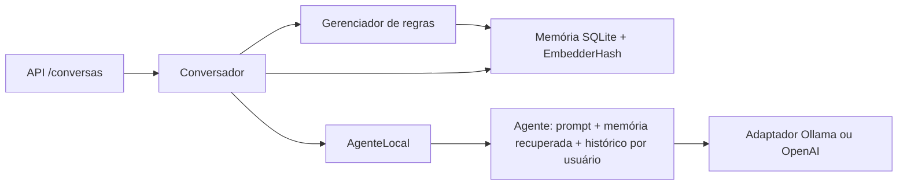

# Decisão de arquitetura: suporte a múltiplos modelos de IA

## Contexto

O projeto Cognitive Memory Agents iniciou sua implementação com um agente baseado em Ollama. Entretanto, o objetivo de longo prazo é permitir que a camada de memória seja reutilizada com diferentes modelos de linguagem, sem dependência obrigatória de um único fornecedor ou runtime.

## Decisão implementada e extensões propostas

A arquitetura usa adaptadores para permitir:

- Modelos hospedados, acessados por APIs de provedores compatíveis.
- Modelos locais, executados por runtimes ou ferramentas compatíveis.
- Diferentes modelos por meio de adaptadores que padronizem a comunicação com o agente.

O Ollama será uma das integrações possíveis, e não um requisito obrigatório para toda a aplicação.

## Separação de responsabilidades

**Agente:** preparar instruções, organizar o contexto e encaminhar solicitações ao modelo selecionado.

**Memória:** persistir informações, recuperar memórias relevantes e tratar atualizações e contradições.

**API:** receber solicitações, coordenar a comunicação entre os componentes e encaminhar as chamadas ao modelo ou provedor configurado.

## Requisitos de integração

- Padronizar a entrada e a saída dos adaptadores de modelos.
- Definir como as memórias recuperadas serão entregues ao agente.
- Evitar dependência da lógica de memória em funcionalidades exclusivas de um provedor.
- Tratar autenticação, credenciais, erros e limites específicos de cada integração.
- Preservar o isolamento entre usuários e o controle de acesso às memórias.
- Avaliar qualidade das respostas, consumo de tokens e latência por modelo.

## Estado atual (revisão de 12/11/2026)

`ModeloLLM.gerar()` define o contrato textual; `gerar_com_detalhes()` é uma capacidade opcional utilizada para métricas. Ollama e OpenAI possuem adaptadores implementados. `AgenteLocal` seleciona e reutiliza adaptadores por provedor/modelo e traduz falhas para os erros de domínio já existentes. Respostas vazias de ambos os provedores compartilham `RespostaModeloVaziaError` (a classe específica OpenAI permanece compatível) e resultam em `503 provedor_indisponivel`. Não há fallback automático.

A API processa as regras, busca memórias persistentes e entrega o contexto ao agente. O histórico de conversa fica em RAM por processo e é limitado a dez interações; memórias recuperadas são inseridas como contexto somente na chamada atual, mas respostas e mensagens podem conservar fatos. A CLI é uma demonstração Ollama com usuário fixo e não conecta a persistência. A memória semântica existe para benchmarks; não é o embedder padrão da API.

Testes simulados validam agente, seleção, adaptadores e erros. Testes com SQLite temporário validam persistência; existe evidência histórica do fluxo Docker. Isso não substitui execução atual dos serviços nem os checkpoints reais P6. A P4-v3 reconhece os treze atributos; a compatibilidade estrutural das anotações é independente da revisão semântica e da avaliação real.

## Pontos para alinhamento da equipe

- Concluir contrato aprovado de esquecimento P6 e evidências de início/reinício/exclusão.
- Definir observação real da RAM da API e a invalidação do histórico após exclusão individual.
- Alinhar o catálogo anunciado pela API aos adaptadores implementados; a configuração de uma chave não implementa um adaptador.
- Validar em execução real os serviços e produzir a avaliação final, preservando a execução local a custo zero.

A integração descrita acima já existe. Os pontos de alinhamento são dependências compartilhadas; endpoints, armazenamento e regras não foram alterados nesta revisão. Detalhes: [agente e provedores](agente-provedores.md) e [guia de avaliação](guia-avaliacao.md).

## Responsabilidades da equipe

Esta divisão segue os escopos informados pela equipe para esta implementação. Mudanças em contratos compartilhados precisam ser alinhadas com os responsáveis.

### Agente e integração com modelos — Zeck

- Manter a lógica do agente independente de um provedor específico.
- Preparar prompts e organizar o contexto recebido da memória.
- Definir uma interface comum para integrar modelos locais e hospedados.
- Avaliar qualidade das respostas, consumo de tokens e latência.
- Integrar os componentes respeitando os contratos acordados pela equipe.

### Memória de longo prazo — Vinicius

- Manter a lógica de memória de longo prazo, extração e esquecimento.
- Desenvolver a recuperação de memórias relevantes.
- Tratar atualização e contradições conforme os requisitos.
- Preparar os dados sintéticos para avaliação.

### API, armazenamento e integração — Paloma

- Alinhar como a API receberá as solicitações e se comunicará com o agente.
- Avaliar como selecionar e configurar o modelo ou provedor utilizado.
- Definir o contrato de comunicação entre API, agente e memória.
- Manter armazenamento, persistência, Docker e infraestrutura.
- Planejar o tratamento de credenciais, erros e particularidades dos provedores.

O agente participa dos contratos de integração, sem alterar unilateralmente endpoints, armazenamento ou regras de memória.

## Critérios para a arquitetura multimodelo

- O Ollama deve continuar como integração local inicial, sem ser uma dependência obrigatória da arquitetura final.
- Modelos hospedados devem ser acessados por integrações compatíveis com as APIs dos respectivos provedores.
- Modelos locais poderão utilizar diferentes runtimes, desde que seja desenvolvido um adaptador compatível.
- A memória deve manter um contrato independente do provedor de IA.
- A seleção do modelo não deve permitir acesso indevido às memórias de outros usuários.
- Custos, latência, limites de contexto e suporte a funcionalidades variam conforme o modelo e o provedor.
