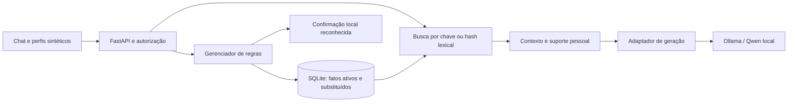

# Arquitetura e decisões da candidata v3

Estado consolidado de 18/11/2026. As decisões descrevem o código implementado; a aprovação humana do PR é registrada separadamente no GitHub. [Visão geral](../README.md), [API](api.md), [avaliação](reproduzir-avaliacao-v3.md).

## ADR-01 — Execução local e adaptadores

**Contexto:** o professor deve executar sem chave paga e a lógica de memória não deve depender de um SDK específico.

**Decisão:** Ollama com `qwen2.5-coder:3b` no caminho da entrega; contrato comum `ModeloLLM`, adaptador e catálogo por provedor/modelo.

**Alternativas descartadas para a entrega:** exigir API paga; acoplar regras ao SDK; anunciar Claude/Gemini sem implementação. O adaptador OpenAI permanece opcional e com testes simulados, sem comparação real.

**Consequências:** pesos e recursos locais precisam ser preparados; CPU é o caminho observado e GPU não é requisito. Qualidade e tokenização variam entre modelos.

## ADR-02 — Persistência e separação por usuário

**Contexto:** fatos precisam sobreviver a novas sessões e reinícios, com atualização e exclusão verificáveis.

**Decisão:** SQLite persistente por usuário, versões ativas/substituídas, recuperação por chave nas consultas reconhecidas e hash lexical no fallback. Histórico recente em RAM por processo.

**Alternativas descartadas para o padrão atual:** manter tudo apenas em RAM; exigir PostgreSQL/pgvector/Qdrant para uma demonstração local; atribuir à API a recuperação semântica usada somente no benchmark separado.

**Consequências:** implantação simples; gramática e busca lexical têm limites. Excluir um ID pode preservar versões inativas; apagar o usuário remove todas as linhas dele e limpa o histórico. Múltiplos workers exigiriam outra política de invalidação/observação.

## ADR-03 — Preparo Docker e acesso de demonstração

**Contexto:** instalação com um comando e sem copiar segredos para o navegador.

**Decisão:** serviços Ollama, preparo e API; o preparo confirma saúde/carregamento e gera credenciais aleatórias persistentes. Chat com cookie HttpOnly/SameSite, origem validada e perfis sintéticos A/B. Banco, pesos e credenciais em volumes separados, API em loopback.

**Alternativas descartadas:** exigir Ollama/Python no host; embutir tokens em JavaScript; começar a API antes de confirmar modelo; reutilizar identidades reais na demo.

**Consequências:** primeiro download pode demorar. Os perfis são compartilhados localmente; exposição pública exige outra configuração e revisão de segurança.

## ADR-04 — Contexto v3 e confirmações locais

**Contexto:** confirmações de operações simples consumiam geração; histórico redundante ampliava contexto. Havia falhas de suporte e negação.

**Decisão:** regras executam gravação/atualização/esquecimento e confirmam localmente quando a mensagem inteira é reconhecida. Perguntas factuais/gerais continuam no modelo; consultas diretas com suporte usam contexto breve. Proveniência e contagem observada acompanham cada resposta. O baseline preserva o histórico completo do episódio.

**Alternativas descartadas:** tratar toda resposta como local; converter `null` em zero; comprimir também o baseline; atribuir a economia exclusivamente ao prompt; apagar fato novo por menção ambígua ao valor antigo.

**Consequências:** redução de tokens demonstrada nos casos medidos, com limites de gramática e referências ambíguas. Regras, banco e hashing continuam tendo custo computacional fora dos tokens do gerador.

## ADR-05 — Evidência por camada e experimentos isolados

**Contexto:** busca vazia ou resposta sem o alvo não prova exclusão de SQLite ou do histórico ativo.

**Decisão:** coletor P6 com API/SQLite temporários, identidades sintéticas, reinícios reais, snapshots e observador RAM opt-in no worker correto. Anotações, fontes e configuração identificadas; resultados e tentativas negativas preservados.

**Alternativas descartadas:** inspecionar outro processo Python e chamar isso de RAM da API; apagar dados de uma instalação habitual; transformar testes simulados em evidência de LLM; reescrever aliases após ver respostas para aumentar acertos.

**Consequências:** observação limitada a um worker e ocorrências literais. Há doze respostas do baseline sem julgamento conclusivo. Revisão humana e análise complementar não alteram retrospectivamente os JSON/P4 originais nem certificam conformidade jurídica.

## Responsabilidades registradas

Ezequiel: agente, contexto, provedores, avaliação e documentação; Vinícius: regras, fatos, conflitos, recuperação e dados; Paloma: API, persistência, Docker e integração. A revisão cruzada e a validação das contribuições dependem dos registros reais de cada integrante.

### Esclarecimento de 21/11: geração local na entrega

O grupo decidiu usar **Ollama com modelo local** para que professor e equipe executem o projeto sem contratar API externa nem depender de créditos de uso. Hardware, energia, armazenamento e download continuam tendo custo; “gratuito” aqui significa ausência de cobrança por uma API de geração no percurso da entrega.

**ChatGPT Plus não é requisito para usar a API da OpenAI nem inclui seu uso.** A API tem acesso e faturamento próprios; uma assinatura do ChatGPT não deve ser tratada como chave de API. A alternativa OpenAI permanece código opcional testado com clientes simulados, sem rodada real e fora do escopo de ativação desta entrega. A escolha não implica que a API esteja comprovadamente executada nem autoriza cobrança.

Fonte oficial: [ChatGPT Plus e separação do uso da API](https://help.openai.com/en/articles/6950777-what-is-chatgpt-plus) e [faturamento separado](https://help.openai.com/en/articles/9039756-managing-billing-for-chatgpt-and-the-api-platform), conferidos em 20/11/2026. Não confundir ferramentas de IA usadas no desenvolvimento com o provedor integrado ao chatbot.
