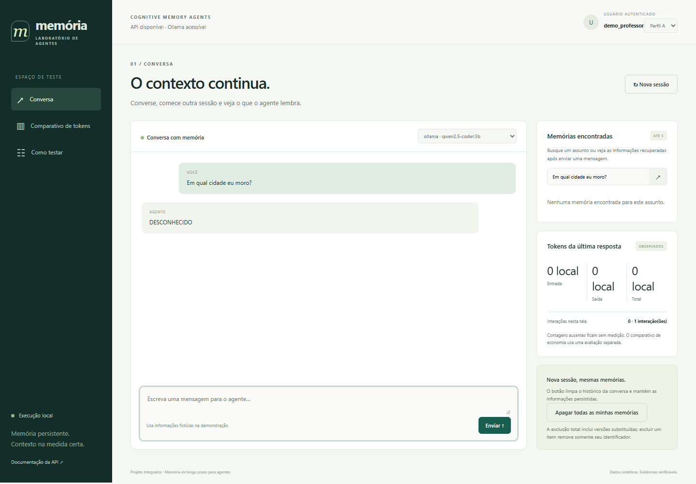
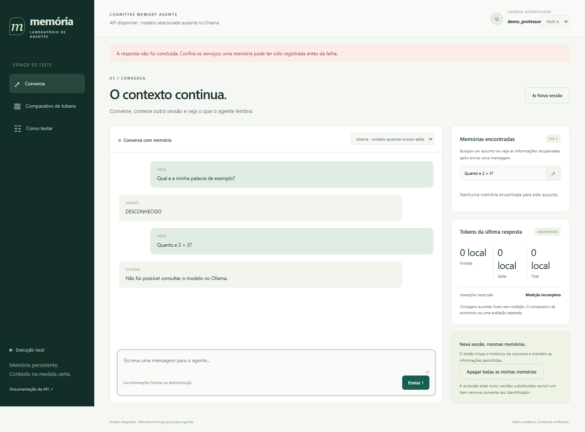
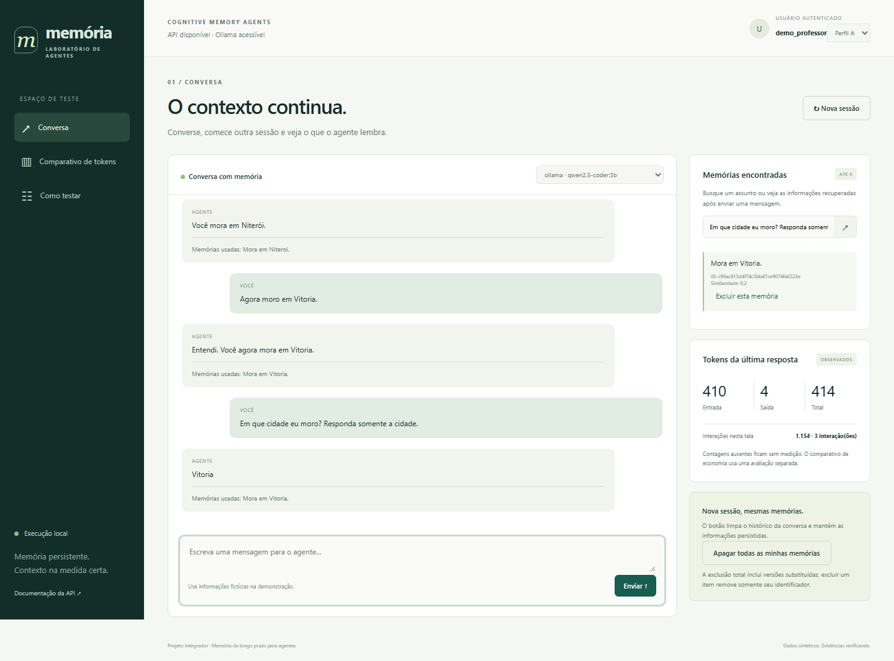

# Manual do professor: Docker e chat real

Versão v3 integrada à `master` pela PR #45. [Conferência de 22/11](../evidencias/fechamento-entrega-20261122/README.md): vídeo dentro de cinco minutos e instalação isolada com 19 verificações aprovadas. A atualização de fechamento está na PR #47, ainda sujeita a revisão; os históricos da PR #46 já foram integrados. Usa Ollama e SQLite reais, sem chave paga. O [índice de 18/11](../evidencias/entrega-v3-20261118/README.md) permanece histórico.

## Baixar a versão correta pelo GitHub

A PR #45 está integrada: use a `master` para a aplicação atual. Os documentos e evidências de fechamento ficam na branch da PR #47 até sua integração. Instale Git somente se for clonar. Alternativa: selecionar a branch no GitHub, clicar em **Code → Download ZIP**, extrair e abrir a pasta que contém `docker-compose.yml`. Depois de publicada a tag `v1.0`, use essa tag para a entrega final.

```powershell
git clone --branch master https://github.com/codezeck/cognitive-memory-agents.git
cd cognitive-memory-agents
git rev-parse HEAD
```

Registre o SHA mostrado. Depois de publicada a tag `v1.0`, usar essa tag como versão de avaliação e conferir a correspondência entre código, vídeo e evidências. Quem já baixou a pasta deve começar a partir dela, sem clonar dentro de outra cópia.

O percurso mínimo é: baixar a versão, iniciar Docker Desktop, executar o comando abaixo, aguardar o preparo do modelo, abrir o chat e conferir a tabela de ações. Python, Node e Ollama no host são necessários apenas nos caminhos opcionais de desenvolvimento, não no uso padrão do professor.

## Preparação e acesso

Instale e inicie Docker Desktop com contêineres Linux e Compose. Abra PowerShell na raiz:

```powershell
.\Iniciar.ps1
```

Alternativa caso a política do PowerShell impeça scripts:

```powershell
docker compose --env-file .env.example -p cma-demonstracao up --build
```

Abra **http://127.0.0.1:8001/**: a página inicial é o chat. **http://127.0.0.1:8001/docs** é a API interativa. O iniciador abre o navegador após confirmar disponibilidade. Não precisa instalar Python/Ollama no host nem copiar tokens. Credenciais aleatórias ficam em volume privado; o servidor autentica os perfis sintéticos por cookie HttpOnly. Se expirar, clique em **Retomar acesso local**.

O comando preserva o `.env` existente. Se a porta estiver ocupada, não pare outro serviço:

```powershell
.\Iniciar.ps1 -Porta 8002 -Projeto cma-professor
```

Primeiro uso exige internet para imagens, dependências e pesos. A camada principal de `qwen2.5-coder:3b` teve **1.929.903.072 bytes**; o modelo completo informa 1.929.912.626 bytes. A imagem local Ollama informa **8.472.913.432 bytes** descomprimidos, além da imagem Python, dependências e banco; tamanho local não é o tráfego comprimido de download. O preparo aguarda Ollama saudável e confirma carregamento real; não há início instantâneo garantido. Foi ensaiado em CPU, com **8.164.077.568 bytes de RAM disponíveis ao Docker (7,60 GiB)**, sem GPU. Isso descreve o ambiente observado, não um mínimo universal. Reserve disco adicional para imagens, dependências, pesos e banco. Pesos e identidades são reutilizados nos próximos inícios; tags de modelos podem mudar no futuro, por isso a avaliação registra também o digest efetivo.

## Conferir disponibilidade

Após o log informar aplicação pronta, abra o chat no endereço mostrado pelo iniciador. Para conferir por PowerShell:

```powershell
Invoke-RestMethod http://127.0.0.1:8001/saude
```

Esperado: `status = ok`. Se iniciou em outra porta, use essa porta também no navegador e na consulta. `/docs` abre a referência OpenAPI; o chat em `/` prepara o acesso automaticamente.

## Ensaio sintético pela interface

Use **A / demo_professor**, sem dados pessoais reais.

| Ação | Pedido sintético | Resultado esperado |
|---|---|---|
| Armazenar automaticamente | `Moro em Niteroi.` | Fato aparece nas memórias |
| Nova sessão e recuperação | `Em qual cidade eu moro?` | Niteroi com memória utilizada |
| Atualizar; nova sessão | `Agora moro em Sorocaba.`; repita a pergunta | Sorocaba, sem usar Niteroi como residência atual |
| Reiniciar API; atualizar página | Comando abaixo; repita a pergunta | Mesma identidade e recuperação do valor atualizado |
| Selecionar perfil B | Pergunte a cidade antes de informar uma | `DESCONHECIDO`; não recupera o fato de A |
| Excluir um ID em A | Botão da memória e confirmação | Remove o ID e reinicia histórico de A; versões inativas podem permanecer |
| Excluir tudo em A | Botão e confirmação | Remove linhas ativas/inativas de A e reinicia histórico; B permanece |
| Perguntar sem suporte | `Em qual cidade eu moro?` após exclusão e nova sessão | `DESCONHECIDO` para essa forma reconhecida |
| Pergunta geral | `Qual e a capital da Franca?` | Resposta do modelo contendo Paris |
| Apoio na mensagem | `Minha palavra de exemplo e NEVOA. Qual e a minha palavra de exemplo?` | Resposta apoiada no pedido atual |

```powershell
docker compose --env-file .env.example -p cma-demonstracao restart api
```

Se iniciou com outro projeto, **substitua** `-p cma-demonstracao` pelo nome usado no iniciador (por exemplo `-p cma-validacao`). Nunca acrescente um segundo `-p`. **Nova sessão** limpa o histórico transitório, preservando SQLite. **Reinício** substitui o processo, preservando banco e credenciais nos volumes. Fechar a aba não apaga memórias. Os perfis locais são compartilhados por quem acessar essa instalação.

Capturas abaixo: ensaio histórico de 14/11; galeria atual no índice da candidata.




## Uso, erros e limites

A interface mostra memórias e tokens reportados. `0 local` exige metadados explícitos `origem_uso=politica_local` e `chamadas_modelo_observadas=0`. Os campos antigos permanecem `null`. Ausência de medição não vira zero; a contagem observa invocações do adaptador, sem contabilizar retries internos do SDK.

Modelo ausente ou Ollama parado produz erro tratado. Falha de conexão com a API aparece na página. Cookie ausente recebe 401; tentativa de atuar como outro usuário recebe 403. Interrupções de serviços foram testadas somente no ambiente isolado.



Busca vazia e abstenção não certificam exclusão completa. A validação inspecionou SQLite somente para leitura e contagens literais no processo real da API por observador opt-in, **desligado por padrão**. Consulte o [relatório](validacao-entrega-docker.md) e a [matriz](andamento-entrega.md).

## Avaliar pela interface, sem terminal

Com o chat aberto, selecione **Comparativo de tokens**. A demonstração local atualizada já habilita as avaliações: não é preciso editar variáveis nem abrir PowerShell para cada teste. Não é necessário importar JSON antes de executar. Se o botão estiver desabilitado, leia o motivo na própria página. Depois de resolver o serviço/modelo indicado, use **Atualizar disponibilidade**. Uma instalação antiga precisa ser atualizada/reconstruída; não basta recarregar o navegador.

1. Escolha **Comparativo sintético v3** ou **P6 · 20 sessões por cenário**.
2. Abra **Ver roteiro, objetivos e perguntas antes de executar**. Confira o que será enviado. Na P6 também estão visíveis os fatos/ações por sessão.
3. No comparativo, escolha **1 · conferência inicial** ou **3 · avaliação repetida completa**. São uma ou três repetições **do mesmo arquivo**, não dois conjuntos diferentes. A P6 mantém uma rodada completa e não permite abreviação nem três repetições nesta tela.
4. Clique em **Executar avaliação** e confirme o tamanho apresentado. A tela acompanha tentativas ou sessões encerradas e perguntas tentadas. Isso indica progresso, não aprovação. O baseline de histórico executa lotes completos: pode haver uma pausa longa no primeiro evento, sem novas contagens por algum tempo.
5. Ao terminar, leia os gráficos, qualidade/cobertura e a explicação dos objetivos. Expanda as perguntas para ver resposta e critérios P4. Ausência de medição aparece como desconhecida; não vira zero. Menos tokens em pares medidos não comprova resposta melhor nem economia nos pares ausentes.
6. Opcionalmente, **Baixar relatório completo JSON** conserva resultados, origem e hashes. **Abrir relatório JSON existente** apenas visualiza o arquivo neste navegador: não gera nova medição nem atribui o histórico a uma rodada atual.

| Opção | Desenho e finalidade | Limites |
|---|---|---|
| Comparativo v3, 1 repetição | 16 casos × 4 cenários = 64 tentativas; conferência menor | Ainda pode levar vários minutos; não reproduz as três repetições originais |
| Comparativo v3, 3 repetições | 16 × 3 × 4 = 192 tentativas; bateria repetida | Dados sintéticos conhecidos, não é teste cego |
| P6 integral | 4 usuários × 5 sessões × 2 cenários = 40 sessões; 42 respostas; 20 pares de sessões | Reinicia somente sua API temporária; observa SQLite/RAM e exige o contrato existente |
| Conjunto próprio de casos | De 1 a 20 casos × 1 ou 3 repetições × 4 cenários | Identificado como próprio; não é a bateria oficial nem P6 |

O gráfico principal compara tokens pareados do histórico completo com a memória automática. A qualidade mostra todos os cenários do protocolo, com aprovações, falhas técnicas e julgamentos pendentes. **Demonstrado nos critérios medidos** significa evidência automática favorável naquele escopo. **Falhou** conserva resultados adversos medidos. **Inconclusivo** indica cobertura insuficiente, ausência de medição ou objetivo fora do protocolo. O comparativo de casos não prova reinício nem exclusão física no SQLite/RAM; esses objetivos exigem os checkpoints P6. Atualização é inspecionada nas questões anotadas, sem inventar uma métrica independente quando ela não existir.

### Criar e importar seus próprios casos

Caso necessário, é possível criar um arquivo para teste próprio. Na aba **Comparativo de tokens**, o painel **Quer criar seus próprios testes?** mostra **Baixar modelo de teste JSON**, sempre visível inclusive quando a P6 está selecionada. O modelo contém um caso real do conjunto oficial; o botão ao lado baixa **os 16 casos oficiais**. O arquivo baixado é de casos independentes e não é um modelo de P6 personalizada.

Abra o arquivo num editor de texto e salve outra cópia com dados fictícios. Também pode fornecer o modelo a uma IA para ajudar a gerar casos seguindo a mesma estrutura; revise fatos, perguntas e respostas esperadas antes de usar. Depois selecione **Comparativo sintético v3 → Meu conjunto de casos → Importar conjunto próprio**. A página valida e mostra as perguntas antes de permitir executar. Use **1 repetição** para conferir primeiro: com apenas um caso são quatro tentativas. Depois, se desejar, use três repetições do mesmo arquivo. Isso não modifica os dados oficiais nem altera uma bateria já em andamento.

O arquivo é uma **lista JSON de objetos**, não um relatório nem um caminho de arquivo. Cada caso contém:

| Campo | Como preencher |
|---|---|
| `id`, `categoria`, `descricao` | ID único com 1–64 letras/números/`_`/`-`; categoria e descrição textuais |
| `mensagens` | 2–16 textos não vazios de até 2000 caracteres; fatos/ações primeiro, pergunta por último |
| `memorias` | Lista dos fatos esperados para o controle pré-carregado, até 32 textos; não é memória extra enviada ao cenário automático |
| `esperado` | Resposta esperada pelo julgador; factual exige texto, abstenção usa o formato do exemplo |
| `estado_regras_esperado` | Objeto com chaves e valores textuais; pode ser vazio |
| `informacoes_esquecidas` | Lista explícita dos alvos esquecidos para medir vazamento; vazia quando não se aplica |
| `avaliacao` | `tipo_resposta` (`factual`/`abstencao`), `atributo` suportado por P4, `aliases_aceitos`, `valores_antigos`, `informacoes_proibidas`; copie a estrutura do exemplo |

Exemplo de edição coerente: ao trocar uma cidade fictícia, atualize fatos, memória esperada, resposta esperada e estado esperado. Não altere aliases depois de ver o resultado para fabricar acerto. Os gabaritos servem ao avaliador; não entram no prompt do modelo, exceto o estado-ouro do controle **pré-carregado**, que faz parte desse cenário e não mede aquisição automática. Regras e P4 têm gramática limitada: uma paráfrase válida pode ficar não verificada ou exigir revisão humana. Criar casos novos não amplia automaticamente essa cobertura.

Limites: 128 KB, 1–20 casos, IDs únicos, 1 ou 3 repetições e até 16 mensagens por caso. Esquema/tipos/metadados, tamanho e vínculos são conferidos no servidor **antes de iniciar o processo ou chamar o modelo**. Campos de comandos, caminhos/URLs de execução, credenciais e protocolo arbitrário não são aceitos. Arquivo inválido mostra o erro e não inicia uma bateria; corrija e importe novamente. A aplicação não executa código contido nos textos. Não use dados pessoais ou segredos.

Importar P6 personalizada **não está implementado**. P6 precisa de dataset de sessões, anotações e contratos de ações vinculados, além de revisão e hashes próprios. Um JSON genérico não será tratado como 20 sessões P6. A opção P6 usa somente seu conjunto oficial congelado.


#### Limites para gerar um conjunto com ajuda de IA

O modelo JSON não define um formato livre. A IA precisa respeitar o contrato
do aplicativo; copiar somente os nomes dos campos não basta. Antes de gerar:

- Crie de **1 a 20 casos diferentes por arquivo**, até **128 KB**. Quarenta
  casos exigem dois conjuntos separados de até vinte, ambos revisados. Não
  aumente o número de casos para representar repetições.
- Cada caso precisa de ID único, categoria/descrição, 2–16 mensagens de até
  2000 caracteres (pergunta por último), memórias, resposta esperada, estado,
  alvos esquecidos e anotações do julgador, como no exemplo baixado.
- Use como `avaliacao.atributo` somente: `cidade`, `esporte`, `carro`, `nome`,
  `time`, `profissao`, `pet`, `filhos`, `disciplina`, `hobby`, `viagem`,
  `quantidade_pets` ou `instrumento`.
- Atributos como `cor_favorita`, `comida_favorita`, `bebida_favorita`,
  `linguagem`, `curso`, `empresa` e `nome_cachorro` não são aceitos como
  atributo principal pelo julgador atual. Não troque apenas o rótulo por
  outro atributo para forçar aceitação: pergunta, fato e anotação precisam
  continuar coerentes. Um teste de nome de animal pode usar `pet`, mas exige
  revisão coerente de todo o caso.
- Quando há um fato disponível e a resposta deve fornecê-lo, use
  `avaliacao.tipo_resposta: "factual"` e um `esperado` com o valor correto.
- Quando o atributo nunca foi informado ou foi explicitamente esquecido,
  use `avaliacao.tipo_resposta: "abstencao"` e prefira
  `esperado: "DESCONHECIDO"`. Não marque esse token como um fato recuperado:
  isso pode produzir aprovação factual indevida no relatório.
- Em atualizações, o gabarito precisa refletir o último fato válido;
  declare os valores antigos e as informações proibidas. Em esquecimento,
  anote os alvos em `informacoes_esquecidas` e `informacoes_proibidas`.
- Mantenha os campos de avaliação do exemplo. Não inclua instruções para o
  aplicativo, comandos, caminhos de execução ou chaves extras dentro do JSON.
  As orientações para a IA devem ficar fora do arquivo importado.

**Vinte casos e quarenta e oito tentativas são coisas diferentes.** O conjunto
oficial tem 16 casos; três repetições dão 48 tentativas por cenário, 192 nos
quatro. Um conjunto próprio de 20 casos dá 20 por cenário em uma repetição
(80 no total) ou 60 por cenário em três repetições (240 no total).
Tentativas não são número de acertos nem número de chamadas ao modelo.

Um arquivo recusado na importação não demonstra falha de memória do agente:
nenhuma bateria foi iniciada. A validação estrutural confere formato, limites
e atributos; ela não substitui a revisão da coerência entre fatos, perguntas
e gabarito, inclusive da classificação factual/abstenção. Um arquivo aceito
também não garante acertos: a execução é que medirá as respostas. O julgador
tem cobertura limitada; novos atributos exigem trabalho próprio de avaliação,
não apenas um JSON novo. Este formato é do comparativo, não de P6 personalizada.

Exemplos da classificação (fragmentos de anotação, não arquivos completos):

```json
{"esperado":"Campinas","avaliacao":{"tipo_resposta":"factual","atributo":"cidade","aliases_aceitos":[],"valores_antigos":[],"informacoes_proibidas":[]}}
```

```json
{"esperado":"DESCONHECIDO","avaliacao":{"tipo_resposta":"abstencao","atributo":"cidade","aliases_aceitos":[],"valores_antigos":[],"informacoes_proibidas":[]}}
```

O segundo fragmento só é correto se o roteiro realmente exigir abstenção;
no esquecimento, acrescente os alvos reais à anotação de proibição.

### Isolamento, interrupções e evidências

Antes de iniciar os casos ou as sessões, a interface confirma que o modelo já está instalado e solicita seu carregamento ao Ollama com prompt vazio, sem baixar pesos nem enviar fatos/perguntas do roteiro. O progresso informa **Carregando o modelo no Ollama; os testes ainda não começaram**, com até 15 minutos para essa preparação. Esse tempo é separado dos tokens e da qualidade dos casos, registrado no relatório como preparação; não representa custo total do sistema medido. O limite global da rodada continua sendo de quatro horas. Se o modelo não ficar pronto, a rodada não inicia e a tela informa a causa. Isso evita que uma inicialização fria consuma o prazo da primeira resposta; não elimina falhas posteriores de recursos ou conexão.

Se a tela informar **Execução encerrada com falhas**, isso não significa que nenhum teste rodou. Um lote de histórico pode falhar e invalidar seus eventos seguintes sem ser repetido. Consulte a causa indicada nos erros, os pares realmente medidos e as respostas ausentes; dados desconhecidos não viram zero. As evidências dessa rodada são conservadas. Uma nova tentativa, quando autorizada, usa outra pasta e não apaga a anterior.

As avaliações usam usuários, credenciais efêmeras, API e SQLite próprios; não reutilizam os perfis A/B nem o banco da conversa. A P6 reinicia somente a API da rodada. Os processos de avaliação não recebem credenciais do chat nem chave paga. O Ollama local é compartilhado e pode ficar mais lento; execute uma bateria por vez. Há trava de concorrência e prazo máximo de quatro horas, com encerramento no fechamento normal da API. Reiniciar/fechar a API durante uma bateria pode interromper o monitoramento: não repetir automaticamente os testes.

Fechar a aba não cancela uma execução em andamento; reabra com o mesmo perfil para acompanhar. Trocar de perfil não revela o relatório do outro. Após reinício da API, um relatório concluído pode ser recuperado pelo identificador guardado no navegador; uma execução incompleta é identificada como parcial/interrompida, sem aprovação automática. Falhas podem ter consumido tokens não recuperáveis.

Cada rodada recebe uma pasta exclusiva `avaliacoes-interface/<identificador>/` no volume de dados, com conjunto próprio quando usado, progresso, log e relatório. A P6 conserva também JSONL e snapshots de SQLite/RAM. Não há sobrescrita dos arquivos históricos. O JSON baixado incorpora o roteiro próprio, julgamentos e, na P6, as evidências operacionais. O download só está disponível ao perfil dono. Mantenha o mesmo projeto Compose e preserve os volumes para conservar esses arquivos.

## Reproduzir testes e experimentos

Para os testes de engenharia, seguir [testes e CI](testes-e-ci.md). Para medir qualidade e tokens com o modelo real em banco/API temporários, seguir [avaliação v3 com Docker](reproduzir-avaliacao-v3.md). Esse caminho não monta o banco do chat nem exige copiar suas credenciais. O [índice](../evidencias/entrega-v3-20261118/README.md) permite comparar fontes, versão, resultados e limites.

## Problemas comuns

| Sintoma | Conferência e ação |
|---|---|
| Docker não responde | Iniciar Docker Desktop e aguardar o mecanismo Linux |
| Porta ocupada | Usar `Iniciar.ps1 -Porta 8002 -Projeto cma-professor`; não parar outro serviço |
| Preparo demora | Acompanhar o download/carregamento; primeira execução não é instantânea |
| Acesso expirou | Usar **Retomar acesso local**; não publicar cookies ou tokens |
| Modelo indisponível ou timeout | Conferir logs do mesmo projeto e disponibilidade do Ollama; preservar o erro observado |
| Botão de avaliação desabilitado | Ler o motivo na tela; atualizar disponibilidade após recuperar Ollama/modelo. Se a instalação for antiga, reconstruir API no mesmo projeto |
| Conjunto JSON recusado | Baixar o modelo de casos, respeitar campos/limites e validar; relatório JSON não é dataset |
| Bateria demorada ou falha | Acompanhar sessões/tentativas; ler falhas/pendências e baixar relatório parcial se disponível. Não executar outra bateria simultânea |
| Resultado do LLM varia | Conferir modelo/digest e contexto; não substituir uma falha por resultado antigo |

As capturas históricas abaixo complementam as anteriores, mostrando atualização e isolamento. Elas não são capturas novas da v3.




## Encerrar sem perder dados

```powershell
docker compose --env-file .env.example -p cma-demonstracao down
```

Substitua `-p cma-demonstracao` pelo projeto que iniciou, por exemplo `-p cma-validacao`. **Não acrescente `-v`**. Para ensaio novo, escolha outro projeto sem apagar volumes anteriores. Banco, pesos e credenciais têm volumes separados.

Esta é uma demonstração local em loopback. Publicação na internet exige desligar `MODO_DEMONSTRACAO`, configurar identidades reais, transporte seguro e revisão de segurança. O modelo tem licença própria Qwen Research; conferir condições antes de outro uso. A guarda pessoal possui gramática limitada. A [P6 v3](acertos-tokens-contexto-v3.md) foi executada separadamente: o percurso do manual não a substitui nem demonstra economia universal de tokens.

## Interpretar qualidade e localizar falhas no relatório

O painel separa **Fatos corretos**, **Abstenções corretas** e **Conteúdo + formato**. Quando o fato deveria estar disponível, “não sei” não conta como resposta factual correta; afirmar um valor errado também é falha. Quando o fato nunca foi informado ou deve ter sido esquecido, a abstenção correta é avaliada separadamente, sem ser apresentada como recuperação. O controle **Sem memória** recebe somente a pergunta final: suas aprovações de abstenção não demonstram lembrança. O controle **Memória pré-carregada** recebe fatos prontos e não mede aquisição automática.

**Conteúdo + formato** só conta registros com aprovação integral explícita dos critérios aplicáveis, sem pendência nem erro técnico. Uma resposta pode estar correta por conteúdo e falhar no formato. Critérios não aplicáveis aparecem separados de julgamentos não verificados. As respostas ausentes e falhas técnicas permanecem visíveis e não viram acertos. Relatórios sem julgamentos detalhados não ganham notas inferidas do resumo.

Na seção **O que aconteceu e quais objetivos foram medidos**, abra **Ocorrências que precisam de atenção**. O filtro separa conteúdo incorreto/abstenção indevida, formato, pendências e falhas técnicas; uma resposta pode ter mais de um motivo. Cada ocorrência mostra cenário, caso, repetição quando disponível, pergunta, esperado, resposta e motivos originais. A lista completa continua abaixo, em **Perguntas, respostas e julgamentos desta execução**. Esses detalhes permitem revisão, mas não há botão de aprovação humana nem alteração retroativa do JSON.

Os gráficos mostram tarefas separadas, com seus próprios denominadores. Por exemplo, 29 fatos corretos e seis abstenções corretas podem compor 35 aprovações de conteúdo; isso não significa 35 fatos recuperados. A resposta final, sozinha, não identifica se uma falha veio da busca ou da elaboração: confira também as memórias usadas e as evidências disponíveis. Um conjunto sintético conhecido não garante desempenho em outras conversas.

## Aparência, resultados e histórico de avaliações

No primeiro acesso, o Caderno abre em **modo escuro**; uma preferência válida já salva tem prioridade. O botão de **lua**, no canto direito do cabeçalho, alterna **Caderno claro** e **Caderno escuro** com um clique. O rótulo acessível indica o modo que será ativado. Ambos usam azul/ciano e preservam a navegação lateral Conversa, Comparativo de tokens e Como testar. A escolha é guardada somente neste navegador; não altera a identidade, o modelo ou a memória do agente. Se o armazenamento local estiver indisponível, a interface continua funcionando.

Na conversa, as últimas 500 mensagens de cada perfil ficam no armazenamento deste navegador, separadas por perfil. Alternar perfis ou recarregar restaura as mensagens; **Nova sessão** e exclusão de memória limpam as mensagens do perfil atual. Elas não são enviadas como contexto ao modelo, não acompanham outro navegador/porta/instalação e podem ser perdidas ao limpar os dados do site. Se o armazenamento estiver bloqueado ou cheio, a conversa continua, mas a persistência após recarregar pode ficar indisponível. Mensagens apagadas antes desta melhoria não são recuperadas. A exclusão exige confirmação em janela do tema; cancelar ou pressionar Escape não exclui dados.

Quando uma rodada termina na aba de avaliação, o resultado aparece antes do formulário e a tela desloca até ele. **Nova avaliação** abre novamente a preparação sem executar nada; ainda é preciso escolher os parâmetros e confirmar a execução. Resultados anteriores ficam no **Histórico de avaliações**, associado ao perfil autenticado e ao volume desta instalação. A lista permite reabrir comparativo v3 e P6, incluindo resultados parciais; abrir, paginar ou baixar não repete chamadas ao modelo. A lista sobrevive ao reinício da API e não depende do navegador guardar o identificador da rodada. Avaliações de outro perfil não aparecem. A data de arquivos antigos é identificada como data do arquivo local quando não existe data de início registrada.

### Mesma tarefa nos quatro cenários

O controle `sem_memoria` original passa pela API e pode retornar abstenção pela política local. **Não equivale ao Ollama nativo sem regras**. Na rodada em que retornou 48 respostas locais e zero chamadas ao modelo, suas 48 aprovações originais medem abstenção, não 48 fatos recuperados. Zero de geração não representa custo total zero. Essa descrição identifica o método dos relatórios anteriores. As novas avaliações da interface usam o controle direto descrito na seção seguinte; sua validação real depende de uma nova rodada explícita.

A interface agora oferece uma análise adicional identificada como **tarefa-comum-p4-v1**: reaplica o julgador P4 existente ao gabarito original incorporado no relatório, igual para todos os cenários. Não muda gabaritos, respostas, prompts nem julgamentos originais. Quando o caso pede um fato disponível no roteiro, responder DESCONHECIDO é falha na tarefa factual, inclusive no controle sem memória. Se esse controle der o fato correto, recebe aprovação pelos mesmos critérios; a memória automática também é reprovada se responder errado. Nos casos em que o fato não existe ou deve ter sido esquecido, a abstenção correta permanece correta. Formato e pendências continuam separados.

Por exemplo, na rodada de 48 respostas por cenário, o controle sem memória pode ficar com 0/33 fatos corretos e 15/15 abstenções necessárias: 15/48 na tarefa comum, enquanto seu julgamento original continua registrando 48/48 abstenções do controle. Isso é uma nova leitura versionada, não uma correção retroativa dos arquivos históricos. O detalhe permite expandir **Julgamento original da execução (preservado)**. O JSON baixado permanece original. Importar um JSON pede à API local apenas essa análise pura, sem persistir o arquivo importado nem iniciar modelos. Sem anotações originais completas e compatíveis, a interface explica a indisponibilidade e conserva a leitura original, sem inventar gabarito. P6 conserva seus critérios originais.

O gráfico de sessão mostra os **quatro cenários** quando presentes, com total, cobertura, chamadas ao modelo e respostas locais. Dados incompletos não viram zero: o total fica desconhecido e o subtotal observado é identificado. A redução principal continua sendo a comparação pareada de memória automática com histórico completo; os outros totais não são apresentados como ganho equivalente em qualidade. Esta bateria mede fatos pessoais sintéticos, não conhecimento geral do modelo nem generalização para qualquer pergunta.

Antes de iniciar uma avaliação, a janela de confirmação do painel mostra protocolo, quantidade prevista e modelo local, nas cores do tema atual. **Cancelar** ou **Esc** fecha a janela sem iniciar chamadas; apenas **Iniciar avaliação** confirma a execução. Uma mudança de perfil enquanto a confirmação está aberta invalida o pedido anterior.


### Controle sem memória nas novas avaliações da interface

A interface usa o método `comparativo-v3-ollama-direto-v1`. Em cada tentativa
de **Sem memória**, envia somente a pergunta final ao Ollama (`/api/chat`),
sem histórico, memórias, agente ou regra local de abstenção, em um POST sem
repetição automática. O modelo e a pergunta são os mesmos do conjunto; os
parâmetros de geração usam os padrões do modelo no Ollama. O gabarito original
P4 avalia a resposta: qualquer cenário pode acertar. “Não sei”/“DESCONHECIDO”
não fornece um fato solicitado, mas continua correto quando o caso exige
abstenção. Isso não demonstra a recuperação interna da memória do modelo.

Os acertos dos quatro cenários aparecem primeiro; depois vêm os tokens de
geração por sessão, chamadas ao modelo e cobertura da medição. Cobertura de
tokens não é acerto de resposta. Contagens ausentes, inválidas ou não
devolvidas em falha permanecem desconhecidas; não são estimadas nem viram
zero. O controle direto registra uma chamada confirmada quando recebe uma
resposta válida do Ollama, mesmo se for “DESCONHECIDO”. A ingestão desse
controle não realiza chamadas. A preparação do modelo fica fora dos tokens
dos casos e não se afirma medir o custo total do sistema.

Relatórios antigos são preservados e identificados como controle via API,
que podia responder por política local sem chamar o modelo. Eles não são
transformados em resultados de Ollama direto. Histórico completo, memória
automática, pré-carregada e o roteiro P6 mantêm seus executores. A memória
pré-carregada continua sendo um controle com estado-ouro, cuja aquisição
não está incluída na medição. Não compare métodos diferentes como se fossem
repetições da mesma configuração.

Para reprodução por CLI, `src.interface.comparativo` preserva o padrão legado
`--controle-sem-memoria api_local`; acrescente
`--controle-sem-memoria modelo_direto` para reproduzir o novo controle Ollama.
Esse modo não está disponível para OpenAI. O JSON novo registra
`controle_sem_memoria`, `versao_metodo_comparativo`, a via `ollama_direto`
e a latência HTTP direta, separada da latência da API do agente.


### Círculos de qualidade

Cada cenário mostra dois círculos independentes: **Fatos corretos** e
**Abstenções corretas**. O número central indica aprovações sobre respostas
classificadas naquele critério. Azul/ciano significa aprovado; coral,
reprovado; âmbar, inconclusivo. A legenda fica abaixo dos círculos e os
valores também são descritos para leitores de tela. Sem classificação e
não aplicável não viram zero acertos ou reprovação. Falhas técnicas e
respostas ausentes permanecem em contagens próprias. Conteúdo + formato
continua exigindo todos os critérios aplicáveis, sem pendência.

Por exemplo, 0/33 pode representar 30 reprovações e três julgamentos
inconclusivos: nenhuma aprovação factual, mas não 33 erros confirmados.
Abster-se quando o fato era solicitado não conta como fornecê-lo. Os
gráficos não alteram respostas, julgamentos ou arquivos históricos.


Os cenários aparecem em faixas verticais. Cada faixa reúne seus círculos,
o total de tokens de geração, entrada/saída, chamadas ao modelo e uma barra
de consumo na mesma escala dos outros cenários. **Ver medição por etapa**
abre ingestão, pergunta final e sessão inteira. Essas etapas não são três
custos adicionais: a sessão inteira é o total. O custo do estado-ouro e da
infraestrutura continua fora da medição. **Mostrar respostas** abre, dentro
da própria faixa, apenas as perguntas, respostas e julgamentos daquele
cenário, incluindo a repetição e as ocorrências registradas. Abrir os
detalhes não executa novamente a avaliação.


## Medição incompleta e tempo limite

Uma faixa com **Medição incompleta** não indica que todos os casos falharam.
Confira a cobertura: por exemplo, 47 de 48 registros medidos e um timeout
significam que falta o consumo completo daquele teste. A faixa informa seu
identificador, repetição, motivo e turnos com retorno registrado. Abra
**Mostrar respostas** para ver o que aconteceu e os critérios de cada caso.
O total permanece desconhecido; o **subtotal observado** reúne os tokens
realmente recebidos, inclusive de turnos concluídos dentro de um caso que
depois falhou. Ele não representa o custo integral. A contagem da chamada
que não respondeu não pode ser recuperada nem substituída por zero.

As novas avaliações do comparativo pela interface usam até **180 segundos
por chamada de modelo nos quatro cenários**. A API temporária recebe mais
margem HTTP (210 segundos); cada caso de histórico é supervisionado por
30 segundos mais 180 por turno. O prazo do provedor é de espera HTTP; o
supervisor limita a duração do caso. O máximo global continua sendo quatro
horas. São limites da avaliação isolada: os adaptadores e regras da conversa
normal e os limites preexistentes da P6 não foram alterados. O preparo do
modelo permanece separado, com até 15 minutos e sem prompt de teste.

As parcelas do histórico são transmitidas ao pai após cada turno concluído.
Timeout, falha ou encerramento do filho preservam o que já foi recebido,
sem repetir perguntas. Falha técnica deixa a execução com estado de falha
e código de saída diferente de zero; resposta semanticamente errada continua
sendo resultado de uma execução, com reprovação nos critérios próprios.
Relatórios anteriores com erro técnico também são identificados como
parciais na leitura, sem alterar o JSON armazenado. Uma rodada encerrada
não é reexecutada ao abrir o histórico.

Os limites efetivos ficam em `limites_execucao` no JSON. Na CLI do wrapper,
`--timeout-modelo 180` reproduz os novos limites da interface; o padrão
legado da CLI continua em 60 segundos. Alterar esse limite não muda o
gabarito, o contexto, os parâmetros de geração ou a regra de aprovação.
Declare a diferença de limites ao comparar rodadas. Nenhum limite garante
que o serviço sempre responderá. Para obter uma medição nova após corrigir
o ambiente, inicie explicitamente outra avaliação e preserve a anterior.

### Origem do diagnóstico desta correção

Na rodada local concluída em 20/11/2026 às 09:31 (São Paulo), o histórico
teve 47 dos 48 registros medidos. O teste V3T016, repetição 3, terminou
com `ProvedorTimeout`, sem retorno contabilizado para seus três turnos.
As duas rodadas anteriores tinham totais completos. Esse diagnóstico é
de uma execução local, não altera os resultados publicados nem comprova
que o timeout tenha sido causado por uma condição específica de recursos.
Seu consumo ausente continua desconhecido; a correção vale para as próximas
rodadas. A validação real dos novos limites deve ocorrer em execução
explícita do responsável.

### Médias dos testes consolidados em 20/11

A [consolidação](consolidacao-testes-20261120.md) distingue o roteiro oficial do personalizado: 84,80% no histórico oficial de versões e 74,13% nas duas rodadas personalizadas da versão atual. Na rodada oficial atual, 84,91%. A média por tentativa considera o episódio inteiro; não é consumo de uma única chamada. Compare os acertos antes dos tokens, preserve reprovados e inconclusivos e leia a cobertura. Medição incompleta não é zero. O botão de histórico reabre os dados locais e não repete avaliações. A [tabela e o recálculo](../evidencias/consolidacao-interface-20261120/README.md) permitem conferir as contas sem modelo.

## Informação antiga na resposta final

Cada faixa mostra a [taxa de informação antiga indevida](informacao-antiga-respostas.md), com oportunidades, cobertura e inconclusivos. Maior taxa é pior. “Mostrar respostas” explica a classificação; sem anotações compatíveis não se assume taxa zero. Os resultados antigos, P4/P5 e tokens continuam preservados. A [conferência offline](../evidencias/informacao-antiga-20261121/README.md) não faz chamadas ao modelo. Esta entrega usa Ollama local, sem depender de créditos de API; [OpenAI permanece opcional](openai-opcional.md#escolha-de-provedor-para-a-entrega).

## P6: tokens ao lado da qualidade

A P6 possui duas faixas, cada uma com círculos de fatos/abstenções e tokens por cenário. São vinte sessões e 21 perguntas por cenário. A medição usa as sessões, sem confundir número de perguntas com cobertura de tokens. Inconclusivo não é erro confirmado; [diagnóstico e exemplos](painel-p6-20261121.md). A leitura dos relatórios existentes não repete chamadas ao modelo nem reescreve julgamentos.


## Leitura atualizada do conteúdo na P6

A [análise de conteúdo versionada da P6](julgamento-p6.md) usa o gabarito incorporado na rodada, igualmente para histórico completo e memória automática. Reconhece formas completas adicionais e separa recusa indevida de abstenção necessária. Os julgamentos originais ficam disponíveis em “Mostrar respostas”; o JSON baixado permanece original. O painel identifica a leitura adicional. Conteúdo, formato, informação proibida e tokens continuam separados. O comparativo sintético e os arquivos próprios não mudaram de critério.


## Proteção dos campos de entrada

A [conferência das entradas](seguranca-entradas.md) explica por que mensagens e arquivos JSON são tratados como dados, sem execução de SQL, comandos ou HTML. Inclui testes com banco temporário e navegador simulado; não é certificação de segurança universal.
