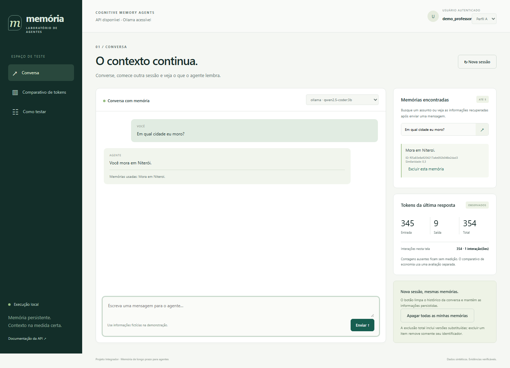

# Manual do professor: Docker e chat real

Versão local de 14/11/2026, sem publicação. PRs #41/#42/#43 integradas na base `2be5d51`; alterações posteriores aguardam revisão. Usa Ollama e SQLite reais, sem chave paga.

## Preparação e acesso

Instale e inicie Docker Desktop com contêineres Linux e Compose. Abra PowerShell na raiz:

```powershell
.\Iniciar.ps1
```

Alternativa caso a política do PowerShell impeça scripts:

```powershell
docker compose --env-file .env.example up --build
```

Abra **http://127.0.0.1:8001/**: a página inicial é o chat. **http://127.0.0.1:8001/docs** é a API interativa. O iniciador abre o navegador após confirmar disponibilidade. Não precisa instalar Python/Ollama no host nem copiar tokens. Credenciais aleatórias ficam em volume privado; o servidor autentica os perfis sintéticos por cookie HttpOnly. Se expirar, clique em **Retomar acesso local**.

O comando preserva o `.env` existente. Se a porta estiver ocupada, não pare outro serviço:

```powershell
.\Iniciar.ps1 -Porta 8002 -Projeto cma-professor
```

Primeiro uso exige internet para imagens, dependências e pesos. A camada principal de `qwen2.5-coder:3b` teve **1.929.903.072 bytes**; o modelo completo informa 1.929.912.626 bytes. A imagem local Ollama informa **8.472.913.432 bytes** descomprimidos, além da imagem Python, dependências e banco; tamanho local não é o tráfego comprimido de download. O preparo aguarda Ollama saudável e confirma carregamento real; não há início instantâneo garantido. Foi ensaiado em CPU, com **8.164.077.568 bytes de RAM disponíveis ao Docker (7,60 GiB)**, sem GPU. Isso descreve o ambiente observado, não um mínimo universal. Reserve disco adicional para imagens, dependências, pesos e banco. Pesos e identidades são reutilizados nos próximos inícios; tags de modelos podem mudar no futuro, por isso a avaliação registra também o digest efetivo.

## Ensaio sintético pela interface

Use **A / demo_professor**, sem dados pessoais reais.

| Ação | Pedido sintético | Resultado esperado |
|---|---|---|
| Armazenar automaticamente | `Moro em Niteroi.` | Fato aparece nas memórias |
| Nova sessão e recuperação | `Em qual cidade eu moro?` | Niteroi com memória utilizada |
| Atualizar; nova sessão | `Agora moro em Sorocaba.`; repita a pergunta | Sorocaba, sem usar Niteroi como residência atual |
| Reiniciar API; atualizar página | Comando abaixo; repita a pergunta | Mesma identidade e recuperação do valor atualizado |
| Selecionar perfil B | Pergunte a cidade antes de informar uma | `DESCONHECIDO`; não recupera o fato de A |
| Excluir um ID em A | Botão da memória e confirmação | Remove o ID e reinicia histórico de A; versões inativas podem permanecer |
| Excluir tudo em A | Botão e confirmação | Remove linhas ativas/inativas de A e reinicia histórico; B permanece |
| Perguntar sem suporte | `Em qual cidade eu moro?` após exclusão e nova sessão | `DESCONHECIDO` para essa forma reconhecida |
| Pergunta geral | `Qual e a capital da Franca?` | Resposta do modelo contendo Paris |
| Apoio na mensagem | `Minha palavra de exemplo e NEVOA. Qual e a minha palavra de exemplo?` | Resposta apoiada no pedido atual |

```powershell
docker compose --env-file .env.example restart api
```

Se iniciou com outro projeto, acrescente `-p cma-professor` antes de `restart`. **Nova sessão** limpa o histórico transitório, preservando SQLite. **Reinício** substitui o processo, preservando banco e credenciais nos volumes. Fechar a aba não apaga memórias. Os perfis locais são compartilhados por quem acessar essa instalação.




## Uso, erros e limites

A interface mostra memórias e tokens reportados. `0 local` exige metadados explícitos `origem_uso=politica_local` e `chamadas_modelo_observadas=0`. Os campos antigos permanecem `null`. Ausência de medição não vira zero; a contagem observa invocações do adaptador, sem contabilizar retries internos do SDK.

Modelo ausente ou Ollama parado produz erro tratado. Falha de conexão com a API aparece na página. Cookie ausente recebe 401; tentativa de atuar como outro usuário recebe 403. Interrupções de serviços foram testadas somente no ambiente isolado.


Busca vazia e abstenção não certificam exclusão completa. A validação inspecionou SQLite somente para leitura e contagens literais no processo real da API por observador opt-in, **desligado por padrão**. Consulte o [relatório](validacao-entrega-docker.md) e a [matriz](andamento-entrega.md).

## Encerrar sem perder dados

```powershell
docker compose --env-file .env.example down
```

Use o mesmo `-p` se escolheu outro projeto. **Não acrescente `-v`**. Para ensaio novo, escolha outro projeto sem apagar volumes anteriores. Banco, pesos e credenciais têm volumes separados.

Esta é uma demonstração local em loopback. Publicação na internet exige desligar `MODO_DEMONSTRACAO`, configurar identidades reais, transporte seguro e revisão de segurança. O modelo tem licença própria Qwen Research; conferir condições antes de outro uso. A guarda pessoal possui gramática limitada. O ensaio não substitui as 20 sessões P6 nem comprova economia global de tokens.
